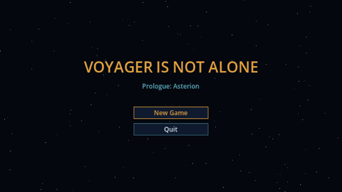
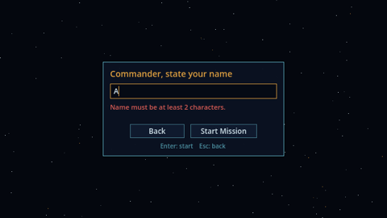
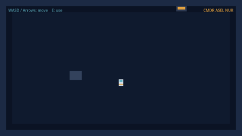

# Отчёт: главное меню, ввод имени, запуск новой игры

**Проект:** Voyager Is Not Alone · **Дата:** 17.11.2026 · **Коммиты:** `c6afbab`, `a0f15f4` · **Godot:** 4.7.2 stable

---

## Итог

Игра теперь начинается с главного меню. New Game открывает ввод имени командира. После подтверждения экран затемняется, загружается комната, и в углу HUD появляется имя командира. Это шаг 1 из пяти на пути к первому сценарию из брифа: новая игра, имя, комната, NPC, квест, сохранение.

Проверка: три тестовых файла, 92 из 92 проверок. Обычный запуск игры проходит без ошибок и предупреждений. Три скриншота сделаны из запуска с окном.

## Что сделано

### Главное меню
- Заголовок, звёздный фон и кнопки New Game и Quit.
- Управление с клавиатуры: фокус сразу стоит на New Game, Enter нажимает кнопку.
- Общая тема интерфейса `scenes/ui/theme/voyager_theme.tres` для кнопок, полей ввода и панелей в палитре проекта. Её будут использовать следующие экраны.



### Ввод имени (требование 3)
- Длина от 2 до 20 символов. Поле не даёт ввести больше 20.
- Разрешены буквы любого алфавита, цифры и одиночные пробелы между словами, так что русские и казахские имена тоже проходят. Требование говорит о буквах и цифрах; я трактую его так, потому что в планах локализация на эти языки.
- Пробелы по краям обрезаются.
- Для каждого случая своё сообщение об ошибке. Оно исчезает, как только игрок начинает исправлять имя.
- Enter запускает игру, Esc возвращает в меню. После запуска форма блокируется, так что двойное нажатие Enter не запустит игру дважды.



### Запуск новой игры
- `GameState.start_new_game()` сохраняет имя, ставит первую главу и флаги `game_started` и `player_name_set`, затем загружает первую сцену.
- Первая сцена задана константой `FIRST_SCENE_PATH`. Пока это прототипная комната; когда появится жилая палуба, достаточно поменять одну строку.
- HUD показывает имя командира (требование 3.6).



### Переходы между сценами
- Вместо пауз по таймеру теперь настоящее затемнение: по 0,25 с на уход и на возврат. Во время перехода мышь заблокирована.
- SceneManager выгружает ту сцену, которая текущая в дереве в момент перехода, а не сохранённую ссылку, которая могла устареть.
- Если новую сцену загрузить не удалось, экран возвращается из затемнения, а не остаётся чёрным.

### Мелкие исправления
- В `.gitignore` больше не исключены файлы `*.import`: в Godot 4 в них хранятся настройки импорта текстур. Это отдельный коммит `c6afbab`.
- `set_player_name()` больше не пишет в лог вторую ошибку при неверном имени: первую уже выводит проверка.

## Тесты

### Новый способ запуска
Первая версия тестов запускалась через `godot -s`. Когда интерфейс начал обращаться к `GameState`, такие тесты перестали компилироваться: в этом режиме глобальные менеджеры подключаются уже после компиляции скриптов. Теперь тест запускается внутри обычной сцены, как сама игра. Запуск всех тестов:
```
tests/run_tests.sh
```
Можно передать конкретные файлы. Скрипт выводит итог по каждому файлу и возвращает код 0, только если всё прошло. Его можно подключить к хуку Kiro или к CI.

### Результаты
| Файл | Что проверяет | Пройдено |
|---|---|---|
| `tests/unit/test_game_state.gd` | 7 допустимых и 7 недопустимых имён с текстами ошибок, `set_player_name()`, пауза и снятие паузы | 30 из 30 |
| `tests/integration/test_new_game_flow.gd` | Фокус и навигация в меню, ввод с клавиатуры, отказ при неверном имени, защита от двойного запуска, флаги, затемнение, сигналы SceneManager, выгрузка меню, имя в HUD | 28 из 28 |
| `tests/integration/test_prototype_room.gd` | Движение, столкновения, терминал (перенесён на новый способ запуска) | 34 из 34 |
| **Всего** | | **92 из 92** |

### Ошибки, найденные тестами
- **Поле имени не принимало ввод.** После фокуса поле не было в режиме редактирования, и после отказа приходилось снова нажимать Enter, чтобы печатать. Так ведёт себя Godot начиная с 4.4. Исправлено: поле сразу открывается для ввода и остаётся в нём после неудачной попытки.
- **Сообщение об ошибке пропадало сразу после появления.** Сигнал об изменении текста приходит с задержкой и стирал только что показанную ошибку. Теперь ошибка стирается только при настоящем изменении текста.

## Статусы в tasks.md
| Задача | Статус |
|---|---|
| 1.3. GameState | **Частично.** Всё проверено, кроме сброса квестов и отношений: эти менеджеры пока заглушки. Проверю вместе с 3.7 и 4.1 |
| 1.4. SceneManager | **Частично.** Загрузка, выгрузка, сигналы и затемнение проверены. Не проверены сохранение состояния игрока между сценами, утечки памяти и случай с несуществующей сценой |
| 10.4. Главное меню | **Частично.** Нет Load Game, Settings, Credits и музыки. Quit работает, но тестом не покрыт |

## Риски и замечания
- Стандартный шрифт Godot по-прежнему немного размыт при 640×360. Нужен пиксельный шрифт с кириллицей, раз имена могут быть русскими и казахскими.
- Коммиты `a94d5aa`, `998d1a2`, `c6afbab`, `a0f15f4` и этот отчёт пока не отправлены на GitHub.

## Следующий шаг
Шаг 2: NPC с диалогом из JSON (задачи 3.1, 3.3, 3.4 и простая часть 3.5). Один персонаж, Элиас Восс, несколько реплик с выбором ответа и подстановкой имени командира. Заодно появится первый формат файлов диалогов.

## Как запустить
- В редакторе: открыть папку в Godot 4.7, нажать F5.
- Из терминала: `/Applications/Godot.app/Contents/MacOS/Godot --path ~/voyagerisnotalone`
- Тесты: `tests/run_tests.sh`
