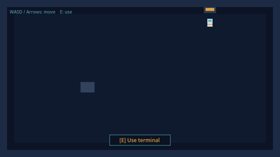
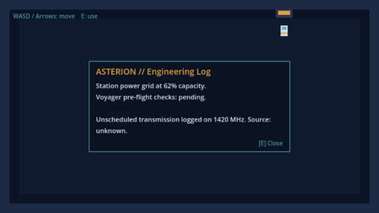

# Отчёт: первый рабочий прототип

**Проект:** Voyager Is Not Alone · **Дата:** 17.11.2026 · **Коммит:** `a94d5aa` · **Godot:** 4.7.2 stable

---

## Итог

Проект запускается и играется: астронавт ходит по комнате, у терминала появляется подсказка `[E] Use terminal`, по E открывается сообщение, повторное E или Esc его закрывает. Это первый шаг вертикального среза из спецификации: персонаж, комната, взаимодействие.

Проверка: автотест `tests/integration/test_prototype_room.gd`, 34 из 34 проверок; два скриншота из запуска с окном; запуск проекта и импорт без ошибок.

## Что было сломано

| Проблема | Последствие | Исправление |
|---|---|---|
| В `game_state.gd` сигнал и переменная назывались `game_started` | Скрипт не компилировался | Сигнал переименован в `new_game_started`, переменная оставлена (её имя есть в критериях задачи 1.3) |
| В `project.godot` не была указана main scene | Godot при запуске зависал | Указана `scenes/prototype/prototype_room.tscn` |
| `SceneManager._ready()` запоминал последний узел корня как текущую сцену | В этот момент это другой менеджер; первый переход удалил бы его | Текущая сцена определяется в момент перехода |

Последняя ошибка в задании не упоминалась. Я нашёл её при проверке запуска и исправил, потому что она ломала бы любой переход между сценами.

## Что сделано

### Управление и физика (`project.godot`)
- Действия `move_up`, `move_down`, `move_left`, `move_right` (WASD и стрелки) и `interact` (E).
- Клавиши привязаны к физическим кнопкам, поэтому WASD работает и на русской раскладке.
- Слои физики названы: 1 — world, 2 — player, 3 — interactable.

### Скрипты
| Файл | Назначение |
|---|---|
| `scripts/components/player_controller.gd` | Движение 120 px/s, нормализация диагоналей, поиск ближайшего объекта в радиусе 32 px, блокировка ввода, задержка 0,2 с между взаимодействиями |
| `scripts/components/interactable.gd` | Базовый класс для всего, с чем можно взаимодействовать: текст подсказки и сигнал `interacted` |
| `scripts/components/terminal.gd` | Терминал: id, заголовок и текст задаются в инспекторе |
| `scripts/ui/hud.gd` | Подсказка у объекта и окно сообщения; пока окно открыто, игрок заблокирован |

### Сцены
- `scenes/player/player.tscn`: игрок с временной графикой из прямоугольников.
- `scenes/prefabs/terminal.tscn`: готовый терминал, который Диас может ставить в свои комнаты.
- `scenes/ui/hud.tscn`: интерфейс в палитре проекта (тёмно-синий, приглушённый голубой, янтарный).
- `scenes/prototype/prototype_room.tscn`: тестовая комната со стенами, ящиком и терминалом.

Тестовая комната лежит в `scenes/prototype/`, а не в `scenes/environments/`: по collaboration.md эта папка принадлежит Диасу.

### Как связаны части
Игрок сообщает HUD, какой объект рядом, и HUD показывает подсказку. По E игрок вызывает `interact()` у объекта, терминал просит HUD показать сообщение. HUD блокирует игрока, пока окно открыто. Терминал не знает про игрока, а игрок не знает про терминал, поэтому двери и NPC подключатся так же.

## Проверка

### Автотест
Запуск без окна:
```
/Applications/Godot.app/Contents/MacOS/Godot --headless --path . -s res://tests/integration/test_prototype_room.gd
```

| Группа проверок | Пройдено |
|---|---|
| Все 5 действий существуют и привязаны к нужным клавишам | 14 из 14 |
| За 1 секунду персонаж проходит 120,0 px, без бокового смещения, останавливается при отпускании | 3 из 3 |
| Скорость по диагонали 120,00 px/s | 1 из 1 |
| Останавливается у левой стены (x = 22,0) и у ящика (x = 178,0) | 2 из 2 |
| Вдали от терминала подсказки нет, E ничего не делает | 3 из 3 |
| У терминала: подсказка, открытие, блокировка движения, закрытие, повторного открытия нет | 11 из 11 |
| **Всего** | **34 из 34** |

### Скриншоты
Сделаны из запуска с окном, разрешение 640×360.

Подсказка у терминала:



Открытое сообщение:



## Статусы в tasks.md

| Задача | Статус |
|---|---|
| 1. Структура проекта | **Выполнено** |
| 1.2. Автозагрузка менеджеров | **Выполнено** |
| 1.3. GameState | **Частично.** `start_new_game()` ссылается на несуществующую `residential_deck.tscn`; пауза не проверена |
| 2.1. Движение | **Частично.** Нет спрайтов и анимаций, не сделан замер 60 FPS |
| 2.4. Обнаружение объектов | **Частично.** Выбор ближайшего из нескольких объектов написан, но не проверен |
| 2.5. Выполнение взаимодействий | **Частично.** Нет NPC, дверей, квестовых предметов и звука |
| 2.6. Базовые объекты | **Частично.** Нет префабов двери и квестового предмета |

## Что пока не сделано
- Графика временная: прямоугольники, без спрайтов и анимаций.
- Камеры нет, комната целиком помещается в экран.
- Остальные менеджеры (диалоги, квесты, сохранения и другие) по-прежнему заглушки.

## Риски и замечания
- В `.gitignore` исключены файлы `*.import`. В Godot 4 их принято хранить в Git: в них лежат настройки импорта текстур, в том числе фильтрация для пиксель-арта. Стоит исправить до того, как Диас добавит первые спрайты.
- Текст интерфейса использует стандартный шрифт Godot. При масштабировании 640×360 он немного размыт; нужен пиксельный шрифт.
- Коммиты `a94d5aa` (код) и следующий за ним (этот отчёт) пока только локальные, на GitHub не отправлены.

## Следующие шаги
1. Камера (задача 2.3) и проверка выбора между несколькими объектами (2.4).
2. Префаб двери и переход между двумя комнатами через SceneManager (1.4, 2.6).
3. Экран ввода имени и запуск новой игры (1.3, требование 3).
4. Затем NPC с первым диалогом из JSON (3.1–3.4).

## Как запустить
- В редакторе: открыть папку в Godot 4.7, нажать F5.
- Из терминала: `/Applications/Godot.app/Contents/MacOS/Godot --path ~/voyagerisnotalone`
- Управление: WASD или стрелки, E у терминала в верхней части комнаты, Esc закрывает сообщение.
