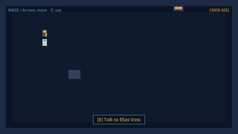
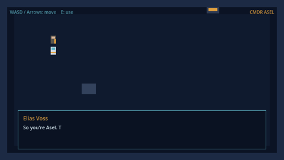
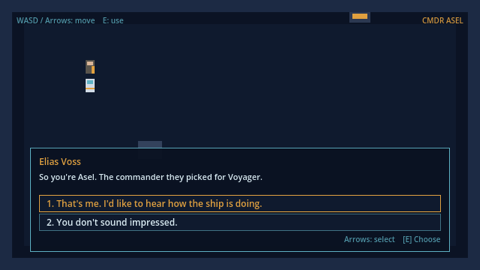

# Отчёт: система диалогов и первый NPC

**Проект:** Voyager Is Not Alone · **Дата:** 20.11.2026 · **Коммиты:** `6438693`, `1aaa419`, `ce332e5` · **Godot:** 4.7.2 stable

---

## Итог

Шаг 2 из пяти готов. В комнате стоит главный инженер Элиас Восс. Подходишь, нажимаешь E, и открывается разговор: текст печатается по буквам, есть выбор ответа, имя командира подставляется в реплики. Диалог хранится в JSON, движок его проверяет и показывает. Повторный разговор начинается иначе, а один вопрос появляется только после того, как игрок прочитал журнал на терминале. Это первая связь между системами: исследование открывает ветку диалога.

Проверка: 6 тестовых файлов, 187 из 187 проверок. Обычный запуск игры проходит без ошибок и предупреждений. Три скриншота сделаны из запуска с окном.

## Как это выглядит

Подсказка рядом с Элиасом:

Текст печатается по буквам, E показывает строку целиком:

Выбор ответа, стрелки переключают вариант:

## Что сделано

### Движок диалогов (DialogueManager)
- Загружает файл из `data/dialogues/`, проверяет его и кэширует.
- Переход по веткам: реплики, варианты ответа, переход к следующей реплике.
- Условия по сюжетным флагам на репликах и на вариантах ответа. Если условие реплики не выполнено, показывается запасная реплика (`fallback_node`). Защита от зацикливания есть.
- Эффект `set_flag` на реплике и на ответе.
- `{player_name}` и `{npc_name}` в тексте.
- Не хранит интерфейс: окно диалога слушает его сигналы. Поэтому логику можно проверять без экрана.

### Проверка файлов
Ошибка в файле не ломает игру молча. Диалог с ошибкой не открывается, а в лог пишется файл, реплика и причина. Проверяются:
- синтаксис JSON с номером строки;
- обязательные поля, неизвестные поля (опечатка вида `next_nod` ловится);
- ссылки на реплики, повторяющиеся id;
- условия и эффекты, которые пока не поддерживаются.

### Окно диалога
- Часть HUD, поэтому работает в любой комнате с HUD.
- Печать по буквам, 50 символов в секунду. E показывает строку целиком, второе E продолжает.
- Варианты ответа кнопками, стрелки переключают, E выбирает.
- Подсказка внизу меняется: «Continue», «Choose» или «Close».
- Пока окно открыто, игрок не двигается, а подсказка взаимодействия скрыта.

### NPC
- Базовая сцена `scenes/npcs/npc_base.tscn`. Новый персонаж — унаследованная сцена с полем `npc_id`.
- Имя и файлы диалогов берутся из `data/npcs/<npc_id>.json`.
- Элиас: сцена, метаданные и диалог из 6 реплик в характере из брифа (сарказм, недоверие к руководству).
- Терминал теперь может ставить сюжетный флаг. Терминал журнала ставит `engineering_log_read`.

### Для Диаса
- `docs/dialogue-format.md` — единственное описание формата: поля, что поддерживается сейчас, шаблоны (первый и повторный визит, ответ, открытый исследованием), правила проверки.
- Проверка контента одной командой: `tests/run_tests.sh tests/content/test_dialogue_content.gd`.
- Новые флаги внесены в общий список в `collaboration.md`.

### Наведение порядка
- Id персонажей были в двух видах: `crew_maya` и `maya_chen`. Теперь везде `имя_фамилия`: `maya_chen`, `elias_voss`.
- Правило `.gitignore` для C# (`data_*/`) задевало папку `scripts/data_loaders/`, и два скрипта не попали в коммит. С чистой копии репозитория проект бы не скомпилировался. Исправлено в `1aaa419`.

## Тесты

| Файл | Что проверяет | Пройдено |
|---|---|---|
| `tests/unit/test_dialogue_manager.gd` | Ошибки загрузки с файлом и строкой, все правила проверки, кэш, запасная реплика, подстановка имён, эффекты, скрытые ответы, защита от повторного старта и неверного выбора, зацикливание | 48 из 48 |
| `tests/integration/test_dialogue_in_room.gd` | Реальные нажатия клавиш: подсказка, пропуск печати, стрелки, блокировка движения, закрытие, повторный визит, вопрос после чтения терминала | 34 из 34 |
| `tests/content/test_dialogue_content.gd` | Все файлы в `data/dialogues`, `data/npcs`, `scenes/npcs`: id совпадает с именем файла, говорящие существуют, все реплики достижимы, флаги зарегистрированы | 13 из 13 |
| Старые тесты (меню, комната, GameState) | Без изменений | 92 из 92 |
| **Всего** | | **187 из 187** |

Проверку контента я проверил отдельно: подложил файл с четырьмя ошибками (неверный id, лишняя реплика, неизвестный говорящий, незарегистрированный флаг). Тест нашёл все четыре. Файл удалён.

### Улучшение тестовой инфраструктуры
Раньше ошибки в логе ловил скрипт запуска по тексту. Теперь каждый тест сам записывает все ошибки движка. Ошибки, которые тест вызывает нарочно, оборачиваются в `capture_log()`; любая другая ошибка проваливает тест.

### Ошибка, найденная тестами
JsonLoader выдавал номер строки на единицу меньше, чем в редакторе: Godot считает строки с нуля. Исправлено.

## Статусы в tasks.md

| Задача | Статус |
|---|---|
| 3.3. DialogueManager | **Выполнено.** Не сделана только анимация появления окна (подзадача 10) |
| 2.5. Выполнение взаимодействий | **Частично.** Добавлено: NPC начинает диалог. Нет дверей и квестовых предметов |
| 3.1. Базовый NPC | **Частично.** Нет спрайта и анимации; поворот к игроку написан, но не проверен |
| 3.2. Метаданные NPC | **Частично.** Есть только Элиас; стартовые отношения записаны, но не используются |
| 3.4. Загрузка JSON | **Частично.** Нет автоматической перезагрузки при изменении файла во время игры |
| 3.5. Условия | **Частично.** Нет условий по отношениям и квестам: эти системы ещё не готовы |

### Отличия от tasks.md
- `start_dialogue()` принимает путь к файлу и id персонажа, как в design.md, а не только id.
- В tasks.md 3.4 перечислены типы реплик TEXT, CHOICE, BRANCH, ACTION, END. Формат следует design.md 3.5 (поля `responses`, `next_node`, `conditions`), он проще для авторов. Всё записано в `docs/dialogue-format.md`.
- NPC содержит `Interactable` как дочерний узел, а не наследует его: этого требует architecture.md (композиция вместо наследования).

## Риски и замечания
- Шрифт по-прежнему стандартный. Нужен пиксельный шрифт с кириллицей.
- Не проверено, как окно диалога показывает реплики длиннее трёх строк. Самая длинная реплика Элиаса занимает две строки. Если Диас будет писать длинные монологи, это нужно проверить до того, как текстов станет много.
- Коммиты `6438693`, `1aaa419`, `ce332e5` и этот отчёт пока не отправлены на GitHub.

## Следующий шаг
Шаг 3: квест от Элиаса. Он даёт задание проверить терминал, чтение журнала выполняет цель, квест закрывается. Для этого понадобятся QuestManager (4.1, 4.2), эффект `start_quest` в диалоге и условие по квесту.

## Как запустить
- В редакторе: открыть папку в Godot 4.7, нажать F5. New Game, ввести имя, подойти к Элиасу (слева вверху) и нажать E.
- Тесты: `tests/run_tests.sh`
