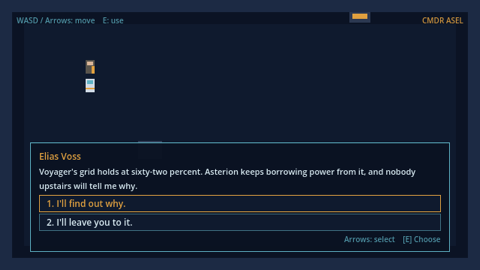
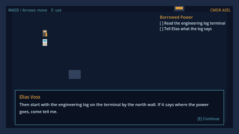
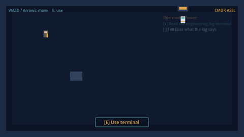
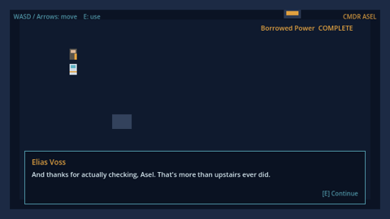

# Отчёт: система квестов и первый квест

**Проект:** Voyager Is Not Alone · **Дата:** 20.11.2026 · **Коммит:** `36d52ea` · **Godot:** 4.7.2 stable

---

## Итог

Шаг 3 из пяти готов. Элиас даёт квест «Borrowed Power»: выяснить, куда станция Asterion уводит энергию с Voyager. Чтение журнала на терминале выполняет первую цель, рассказ Элиасу о сигнале 1420 MHz — вторую, и квест закрывается. Справа вверху видно название квеста и цели с отметками.

Теперь работает вся цепочка из брифа до сохранения: новая игра, имя, комната, разговор с NPC, получение квеста, действие, обновление квеста. Остался шаг 5, сохранение.

Проверка: 8 тестовых файлов, 273 из 273 проверок. Обычный запуск игры проходит без ошибок и предупреждений. Четыре скриншота сделаны из запуска с окном.

## Как это выглядит

Элиас предлагает квест:

Квест получен, справа появились цели:

Журнал прочитан, первая цель отмечена. Игрок стоит под трекером, поэтому трекер становится прозрачным:

Рассказ Элиасу закрывает квест:

## Что сделано

### QuestManager
- Квесты описываются в `data/quests/<quest_id>.json`. Файл проверяется при загрузке и кэшируется.
- Описание квеста хранится отдельно от прогресса. Прогресс — это статус и отметки целей. На шаге 5 сохранять нужно будет только его.
- Статусы: `not_started`, `active`, `completed`, `failed`.
- Цель типа **`story_flag`** выполняется сама, когда сюжетный флаг принимает нужное значение. Если игрок прочитал журнал раньше, чем взял квест, цель засчитывается сразу при старте.
- Цель типа **`talk_to`** выполняется из диалога, эффектом `update_quest` на нужной реплике.
- Условия старта: сюжетные флаги и завершённые квесты.
- Награда: сюжетные флаги. Они ставятся до сигнала о завершении, поэтому следующий квест уже видит этот выполненным.

### Связь с диалогами
- Условие `quests`: реплика или ответ видны только при нужном статусе квеста.
- Эффекты `start_quest` и `update_quest`.
- В диалоге Элиаса предложение квеста видно, только пока квест не начат.
- Благодарность «And thanks for actually checking» звучит, только если квест активен, и закрывает его.
- После завершения квеста у Элиаса остаётся только ответ «I'll leave you to it.».

### Трекер квестов в HUD
- Название квеста и цели с отметками `[ ]` и `[x]`, обновляются сразу.
- Выполненный квест показывается с пометкой COMPLETE 4 секунды и исчезает.
- Терминал журнала стоит прямо под трекером, и на первом скриншоте трекер закрывал игрока. Теперь трекер становится прозрачным, когда игрок под ним.

### Для Диаса
- `docs/quest-format.md`: поля квеста, типы целей, как начинать и завершать квест из диалога, правила проверки.
- `docs/dialogue-format.md` дополнен новыми условием и эффектами.
- Проверка контента теперь охватывает и квесты. Флаги в условиях, целях и наградах должны быть в общем списке. NPC в целях `talk_to` и квесты в условиях старта должны существовать. Диалоги могут ссылаться только на существующие квесты и цели.

Я подложил испорченный квест и диалог с пятью ошибками в ссылках, проверка нашла все пять.

## Тесты

| Файл | Что проверяет | Пройдено |
|---|---|---|
| `tests/unit/test_quest_manager.gd` | Ошибки загрузки, правила проверки, условия старта, выполнение целей, необязательные цели, порядок сигналов и наград, цепочка квестов, флаг до старта, провал, сброс | 57 из 57 |
| `tests/integration/test_quest_in_room.gd` | Весь квест реальными нажатиями: предложение, получение, трекер, терминал, отчёт Элиасу, награда, прозрачность трекера, диалог после завершения | 36 из 36 |
| `tests/content/test_dialogue_content.gd` | Добавлены квесты и ссылки на них | 17 из 17 |
| `tests/integration/test_new_game_flow.gd` | Добавлено: новая игра сбрасывает квесты и флаги | 31 из 31 |
| `tests/integration/test_dialogue_in_room.gd`, `tests/unit/test_dialogue_manager.gd` | Обновлены под новые ответы, условия и эффекты | 36 и 51 |
| Остальные | Без изменений | 64 из 64 |
| **Всего** | | **273 из 273** |

## Статусы в tasks.md

| Задача | Статус |
|---|---|
| 4.1. QuestManager | **Выполнено.** API немного другое: цель отмечается через `complete_objective()`, квест закрывается сам |
| 4.2. Загрузка квестов | **Выполнено.** Поддерживается часть схемы из design.md, остальное отклоняется проверкой |
| 4.3. Журнал квестов | **Частично.** Есть трекер в HUD; нет журнала по Tab с разделами активных и выполненных |
| 4.4. Квесты и взаимодействия | **Частично.** Нет проверки при переходе между сценами: второй сцены пока нет |
| 1.3. GameState | **Частично.** Сброс квестов и флагов проверен, остался сброс отношений (3.7) |
| 3.5. Условия в диалогах | **Частично.** Добавлены условия по квестам, нет условий по отношениям |

## Риски и замечания
- Терминал журнала отмечает цель через сюжетный флаг. Для MVP этого хватает. Если понадобятся объекты, которые засчитываются только во время квеста, нужен отдельный тип цели `investigate`.
- Журнала по Tab пока нет. Трекера хватает, пока у игрока один-два квеста.
- Коммит `36d52ea` и этот отчёт пока не отправлены на GitHub.

## Следующий шаг
Шаг 4: доверие и привязанность (задача 3.7). Ответы Элиасу меняют trust и bond, а диалог может проверять их значения. После этого остаётся шаг 5: сохранение и загрузка.

## Как запустить
- В редакторе: открыть папку в Godot 4.7, нажать F5. New Game, ввести имя, подойти к Элиасу и выбрать «I'll find out why.». Затем прочитать терминал у северной стены и вернуться к Элиасу.
- Тесты: `tests/run_tests.sh`
