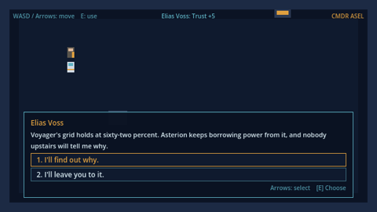
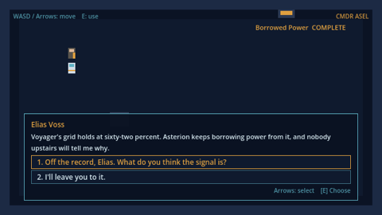

# Отчёт: доверие и привязанность экипажа

**Проект:** Voyager Is Not Alone · **Дата:** 20.11.2026 · **Коммиты:** `918b5d7`, `e5491f0` · **Godot:** 4.7.2 stable

---

## Итог

Шаг 4 из пяти готов. У каждого члена экипажа два значения от 0 до 100:
- **доверие (trust)**: уверенность в игроке как в командире;
- **привязанность (bond)**: личная связь.

Ответы в диалоге и завершённые квесты меняют их, а диалоги и квесты могут от них зависеть.

На Элиасе это работает так: он начинает с доверием 40, потому что не доверяет руководству. Чтобы он поделился своей версией о сигнале, игрок должен заработать доверие 60: деловой вопрос о корабле (+5) и выполненный квест (+15). Если пропустить квест, этот ответ не появится.

Проверка: 9 тестовых файлов, 367 из 367 проверок. Обычный запуск игры проходит без ошибок и предупреждений. Два скриншота сделаны из запуска с окном.

## Как это выглядит

Деловой ответ повышает доверие, вверху появляется уведомление:

После квеста доверие 60, и открывается новый вопрос:

## Что сделано

### RelationshipManager
- Доверие и привязанность для Майи, Элиаса, Норы и Дэниела, от 0 до 100.
- Стартовые значения берутся из `initial_relationships` в `data/npcs/<id>.json`. Если файла или поля нет, значение 50, как в требовании 22.
- Изменения не выходят за пределы 0–100. Метод возвращает фактически применённое изменение.
- Сигнал `relationship_changed` с прежним и новым значением. Если значение не изменилось (уже на пределе), сигнала нет.
- Уровни из design.md: 0–25 низкий, 26–50 нейтральный, 51–75 хороший, 76–100 высокий.
- Новая игра сбрасывает отношения к стартовым значениям.

### Связь с диалогами и квестами
- Условие `relationships` в диалогах: реплика или ответ видны, только если доверие или привязанность в заданных пределах.
- Эффект `change_relationship` на реплике или ответе.
- В квестах отношения можно указать в условиях старта и в наградах. Проваленный квест награду не даёт.

### Уведомления в HUD
- Изменения показываются вверху по центру, например «Elias Voss: Trust +5». Рост выделен голубым, падение красным.
- Уведомление держится 3 секунды и плавно гаснет. На экране одновременно не больше четырёх.

### Контент Элиаса

| Действие | Изменение |
|---|---|
| Вопрос о состоянии корабля | доверие +5 |
| Замечание о его тоне | привязанность +5 |
| Рассказ о журнале и сигнале | привязанность +5 |
| Завершение квеста «Borrowed Power» | доверие +15 |
| Доверие 60 и больше | открывает вопрос «Off the record» и его версию о сигнале |

Доверие и привязанность растут от разных ответов. Так в брифе: персонаж может хорошо относиться к игроку лично и при этом сомневаться в нём как в командире.

### Для Диаса
- `docs/dialogue-format.md`: условие и эффект с примерами, разница между доверием и привязанностью, обычные величины изменений (±3–5 за ответ, ±10–15 за квест), шаблон «ответ, открытый доверием».
- `docs/quest-format.md`: отношения в условиях старта и наградах.
- Проверка контента теперь ловит ошибки в отношениях: персонаж не из экипажа, неизвестный тип, дробные числа или выход за 0–100, неизвестные поля в стартовых значениях. Я подложил пять таких ошибок, проверка нашла все пять.

### Ошибка, найденная тестами
Проверка файлов падала, если в JSON не хватало поля: сравнение «значение входит в список» в GDScript вызывает ошибку, когда значения нет. Все проверки данных из файлов теперь используют безопасный вариант.

## Тесты

| Файл | Что проверяет | Пройдено |
|---|---|---|
| `tests/unit/test_relationship_manager.gd` | Стартовые значения, изменения и пределы, сигналы, неверные данные, уровни, условия, правила проверки, сброс | 50 из 50 |
| `tests/integration/test_quest_in_room.gd` | Добавлено: доверие 40 → 45 → 60, уведомления, новый ответ появляется | 46 из 46 |
| `tests/integration/test_dialogue_in_room.gd` | Добавлено: без квеста доверие остаётся 40, и ответ скрыт | 40 из 40 |
| `tests/unit/test_quest_manager.gd` | Добавлено: отношения в условиях старта и награде, нет награды за провал | 62 из 62 |
| `tests/unit/test_dialogue_manager.gd` | Новые правила проверки для отношений | 56 из 56 |
| `tests/integration/test_new_game_flow.gd` | Добавлено: новая игра сбрасывает отношения | 32 из 32 |
| Остальные | Без изменений | 81 из 81 |
| **Всего** | | **367 из 367** |

## Статусы в tasks.md

| Задача | Статус |
|---|---|
| 3.7. RelationshipManager | **Выполнено** |
| 1.3. GameState | **Выполнено.** Последний критерий, сброс отношений, проверен |
| 3.5. Условия в диалогах | **Частично.** Все типы условий есть, нет отладочного журнала проверок |
| 3.6. Эффекты в диалогах | **Частично.** Нет выдачи предметов (инвентаря пока нет) и журнала действий |

### Отличие от tasks.md
В tasks.md 3.7 доверие задано от −100 до 100. В requirements.md (требование 22) и design.md 3.7 оба значения от 0 до 100. Я сделал по требованиям, а отличие записал в tasks.md.

## Риски и замечания
- Экрана отношений из требования 24.3–24.6 нет. Пока в игре один член экипажа, уведомлений хватает. Экран понадобится, когда появятся Майя, Нора и Дэниел.
- Числа для Элиаса подобраны на глаз. Их нужно проверить в игре: заметна ли разница между путями и не слишком ли легко или трудно открыть его версию.
- Коммит `918b5d7` уже на GitHub. Коммит `e5491f0` (документация, проверка стартовых значений, статусы задач) и коммит с этим отчётом пока только локальные.

## Следующий шаг
Шаг 5: сохранение и загрузка одной ячейки (задачи 9.1, 9.2). Сохраняются имя, сцена и позиция, сюжетные флаги, квесты и отношения. Тест проверит, что после загрузки состояние совпадает с сохранённым. На этом первый играбельный сценарий из брифа будет пройден целиком.

## Как запустить
- В редакторе: открыть папку в Godot 4.7, нажать F5. New Game, поговорить с Элиасом, выбрать вопрос о корабле, пройти квест и поговорить с ним ещё раз.
- Тесты: `tests/run_tests.sh`
