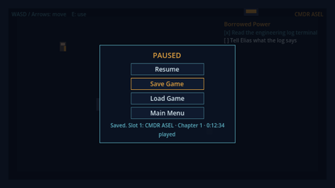
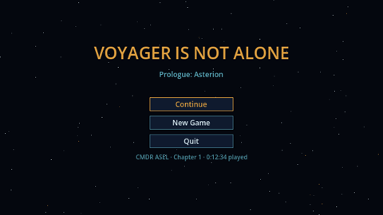

# Отчёт: сохранение и загрузка, первый сценарий пройден

**Проект:** Voyager Is Not Alone · **Дата:** 21.11.2026 · **Коммит:** `3a167c0` · **Godot:** 4.7.2 stable

---

## Итог

Шаг 5 из пяти готов, и вместе с ним первый играбельный сценарий из брифа:

**новая игра → ввод имени → прогулка по комнате → разговор с NPC → получение квеста → действие → обновление квеста → сохранение.**

Игру можно сохранить из меню паузы (Esc), выйти в главное меню и продолжить кнопкой Continue. Восстанавливается всё: имя, глава, время игры, сцена, место игрока, сюжетные флаги, квесты и отношения с экипажем. Load Game в меню паузы возвращает игру к сохранению.

Проверка: 11 тестовых файлов, 465 из 465 проверок. Один из тестов проходит весь сценарий целиком реальными нажатиями клавиш. Обычный запуск игры проходит без ошибок и предупреждений. Два скриншота сделаны из запуска с окном.

## Как это выглядит

Меню паузы после сохранения:

Главное меню с кнопкой Continue и данными сохранения:

## Что сделано

### SaveManager
- Три ячейки: `user://saves/slot_1.json` … `slot_3.json`. На macOS это папка данных приложения Godot.
- Сохраняются имя командира, глава, время игры, путь к сцене и позиция игрока, все сюжетные флаги, прогресс квестов и отношения.
- Файл JSON с отступами и отсортированными ключами, его можно открыть и прочитать (требование 52.4). Описание формата: `docs/save-format.md`.
- Запись идёт во временный файл, который потом заменяет старый. Если игра упадёт во время сохранения, предыдущее сохранение не пострадает.
- Нельзя сохраниться во время разговора и во время смены сцены: игра объясняет, почему.

### Загрузка и проверка файла
- Файл проверяется целиком до того, как что-то восстанавливается. Если он повреждён, текущая игра не меняется, а игрок видит причину.
- Проверяются синтаксис JSON (с номером строки), версия формата, неизвестные и отсутствующие поля, имя командира (по тем же правилам, что при вводе), глава 1–7, существующая сцена `res://`, числовая позиция, типы значений флагов, существующие квесты и цели, только члены экипажа и доверие с привязанностью 0–100.
- Версия формата: 1. Сохранение из более новой версии игры отклоняется одним понятным сообщением, а не десятком ошибок полей. Место для перевода старых форматов (`_migrate()`) готово.
- При загрузке нет повторных уведомлений об отношениях и повторных наград за квесты.
- Флаги, квесты и члены экипажа, которых нет в сохранении, получают значения новой игры. Поэтому старые сохранения загрузятся и после добавления контента.

### Меню паузы и Continue
- Esc открывает паузу: Resume, Save Game, Load Game, Main Menu и строка о состоянии ячейки. Игра стоит, игрок не двигается.
- Во время разговора Esc не открывает паузу. Если открыто сообщение терминала, Esc сначала закрывает его.
- В главном меню кнопка Continue появляется, только если есть сохранение. Под кнопками видно командира, главу и время игры. Повреждённое сохранение делает кнопку неактивной и показывает причину.

### Мелкие изменения
- SceneManager получил сигнал `scene_loaded`: новая сцена уже на месте, но экран ещё тёмный. Через него игрок ставится на сохранённое место до того, как экран посветлеет.
- Сюжетные флаги приводят целые числа к целому типу. JSON хранит все числа одинаково, и без этого флаг 3 после загрузки стал бы 3.0 и не совпал бы с условием.
- Выход в главное меню сбрасывает сессию и снимает паузу.

## Тесты

| Файл | Что проверяет | Пройдено |
|---|---|---|
| `tests/unit/test_save_manager.gd` | Сохранение и загрузка дают те же данные; 200 случайных состояний (фиксированное зерно) переживают сохранение и загрузку; 18 видов повреждённых файлов; версии; пустые и несуществующие ячейки; неудачная загрузка не меняет игру; формат времени | 51 из 51 |
| `tests/integration/test_save_load_flow.gd` | Весь сценарий клавишами: новая игра, квест, терминал, правила Esc, сохранение, выход в меню, Continue, место и прогресс восстановлены, квест доходится, Load Game откатывает | 47 из 47 |
| Остальные 9 файлов | Без изменений поведения | 367 из 367 |
| **Всего** | | **465 из 465** |

Все тесты теперь пишут в отдельную папку `user://test_saves/` и очищают её. Настоящие сохранения игрока они не трогают; я проверил, что папка `saves` после тестов пуста.

### Что нашли случайные тесты
Дробные числа (например, флаг со значением −42.0794296264648) после первого сохранения могут отличаться в последнем знаке: разбор JSON в Godot не всегда округляет 17-значные десятичные числа точно. Повторное сохранение уже совпадает до бита. На игру это не влияет: позиции, время и флаги остаются точными с относительной погрешностью около 1e-14, а целые числа, текст и логические значения совпадают точно. Тест сравнивает дробные числа приблизительно и объясняет почему.

## Статусы в tasks.md

| Задача | Статус |
|---|---|
| 9.1. Сохранение | **Частично.** Нет состояния головоломок: PuzzleManager пока пуст |
| 9.2. Загрузка | **Частично.** То же; перевода старых форматов нет, потому что версия 1 первая |
| 9.3. Экран ячеек | **Частично.** Работает ячейка 1 из паузы и Continue; нет экрана трёх ячеек, удаления и подтверждений |
| 9.4. Автосохранение | **Не начато** |
| 10.4. Главное меню | **Частично.** Добавлен Continue; нет Settings, Credits, музыки |
| 10.5. Меню паузы | **Частично.** Нет Settings и подтверждения выхода в меню |

## Итог первого этапа (шаги 1–5)

| Шаг | Что работает | Отчёт |
|---|---|---|
| 1 | Главное меню, ввод имени, запуск игры, затемнение | 17.11 |
| 2 | Элиас и диалоги из JSON с ветвлением | 20.11 |
| 3 | Квест «Borrowed Power» и трекер | 20.11 |
| 4 | Доверие и привязанность, ответ, открытый доверием | 20.11 |
| 5 | Сохранение, загрузка, пауза, Continue | этот |

Системы связаны между собой, как требует категория Frankenstein: чтение терминала выполняет цель квеста и открывает ветку диалога; квест повышает доверие; доверие открывает новую версию событий; сохранение переносит всё это между сессиями.

## Риски и замечания
- **Выход в меню без подтверждения.** «Main Menu» в паузе сразу выходит, и несохранённый прогресс теряется. Стоит добавить подтверждение до того, как игру увидят другие.
- **Только ячейка 1.** SaveManager поддерживает три ячейки, но интерфейс пока использует одну.
- **Сохранение не проверено на Windows.** Замена файла переименованием проверена на macOS.
- **Нет пиксельного шрифта** с кириллицей. Это замечание из прошлых отчётов, оно остаётся.
- **Не отправлено на GitHub:** `e5491f0`, `5a3cd84`, `3a167c0` и коммит с этим отчётом.

## Что дальше
Первый сценарий готов. По tasks.md и брифу дальше идут:
1. Подтверждение выхода в меню и экран трёх ячеек (10.5, 9.3): небольшая доработка, чтобы игру можно было показывать.
2. Дверь и вторая комната (1.4, 2.6): нужны для двух палуб MVP и проверки переходов с сохранённым состоянием.
3. Головоломка энергосети (6.x): первая из двух головоломок MVP.

## Как запустить
- В редакторе: открыть папку в Godot 4.7, нажать F5. New Game, ввести имя, взять квест у Элиаса, нажать Esc → Save Game → Main Menu → Continue.
- Тесты: `tests/run_tests.sh`
