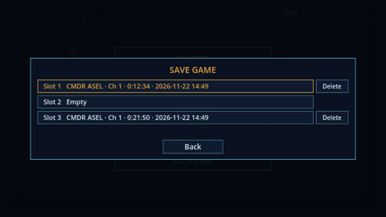
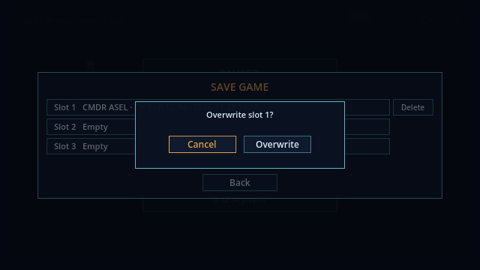
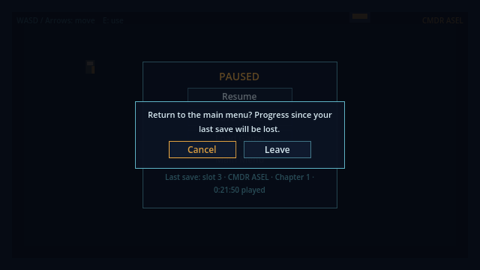

# Отчёт: три ячейки сохранения и подтверждения

**Проект:** Voyager Is Not Alone · **Дата:** 22.11.2026 · **Коммит:** `8173987` · **Godot:** 4.7.2 stable

---

## Итог

Закрыты два главных замечания прошлого отчёта:
- **Экран трёх ячеек.** Раньше интерфейс работал только с ячейкой 1. Теперь из паузы можно сохраняться в любую из трёх ячеек и загружать любую, а из главного меню загружать.
- **Подтверждение выхода в меню.** Раньше «Main Menu» в паузе выходил сразу и терял несохранённое. Теперь игра спрашивает, если со времени сохранения что-то изменилось.

Перезапись, удаление и загрузка поверх несохранённой игры тоже подтверждаются. Continue в главном меню загружает самое свежее сохранение.

Проверка: 12 тестовых файлов, 543 из 543 проверок. Обычный запуск игры проходит без ошибок и предупреждений. Три скриншота сделаны из запуска с окном.

## Как это выглядит

Экран ячеек при сохранении. У занятых ячеек командир, глава, время игры и дата, есть кнопка Delete:

Перезапись спрашивает подтверждение, «Cancel» выбран по умолчанию:

Выход в меню с несохранённым прогрессом:

## Что сделано

### Экран ячеек
- Три ячейки. Занятая показывает командира, главу, время игры, дату и время сохранения. Пустая показана как «Empty». Повреждённая показывает причину.
- **Режим сохранения** (из паузы): в пустую ячейку сохраняется сразу, в занятую после подтверждения «Overwrite slot N?».
- **Режим загрузки** (из паузы и главного меню): пустые и повреждённые ячейки неактивны. Если в текущей игре есть несохранённый прогресс, игра сначала спрашивает.
- Delete удаляет ячейку после подтверждения «Delete slot N? This cannot be undone.».
- Esc или Back закрывает экран и возвращает в меню, из которого его открыли.

### Диалог подтверждения
- Один диалог на все случаи. По умолчанию выбран «Cancel», поэтому случайное нажатие Enter ничего не удаляет. Esc тоже отменяет.
- После ответа фокус возвращается на кнопку, с которой был вызван диалог.

### Несохранённый прогресс
- `SaveManager.has_unsaved_progress()` сравнивает текущую игру с состоянием на момент последнего сохранения, загрузки или начала новой игры.
- Учитываются сюжетные флаги, квесты, отношения, имя и глава. Перемещение по комнате и время игры не учитываются, иначе подтверждение появлялось бы всегда.
- В меню паузы под кнопками видно последнее сохранение и пометка «Unsaved progress».

### Главное меню
- Continue загружает самое свежее рабочее сохранение. Для этого в файл добавлено время сохранения с долями секунды (`saved_unix`): два сохранения в одну секунду иначе не различить.
- Новая кнопка Load Game открывает экран ячеек.
- Если все сохранения повреждены, Continue неактивен, меню объясняет причину, а фокус стоит на New Game.

## Ошибки, найденные при проверке

### Фокус уходил за пределы окна
Godot переводит фокус стрелками на ближайшую кнопку на экране. Кнопки меню паузы остаются на экране за диалогом, поэтому стрелка вправо в диалоге «Load slot 1?» уходила на кнопку за ним. Enter после этого нажимал не то. Тест это поймал.

Теперь у диалога и экрана ячеек явно заданы соседи для стрелок и Tab (`scripts/ui/focus_utils.gd`). Тест нажимает все стрелки и Tab и проверяет, что фокус остаётся внутри. Я отдельно отключил эти связи, и тест сразу провалился. Значит, он действительно это проверяет.

### Обрезанный текст в ячейках
На первом скриншоте строки обрезались, а у пустой ячейки кнопка была шире, чем у занятых. Исправлено:
- строка стала короче: «CMDR ASEL · Ch 1 · 0:12:34 · 2026-11-22 14:49»;
- экран стал шире;
- колонка Delete сохраняет ширину, даже когда кнопки нет.

Тест проверяет, что самое длинное допустимое имя (20 символов) с временем игры 9:59:59 помещается без обрезки.

## Тесты

| Файл | Что проверяет | Пройдено |
|---|---|---|
| `tests/integration/test_save_slots.gd` | Подтверждение выхода и отмена, сохранение в пустые ячейки, перезапись с отменой и согласием, удаление, фокус внутри окон, длинное имя, выход без подтверждения после сохранения, Continue и Load Game в главном меню, повреждённые ячейки | 69 из 69 |
| `tests/integration/test_save_load_flow.gd` | Весь сценарий перенесён на экран ячеек | 56 из 56 |
| Остальные 10 файлов | Без изменений поведения | 418 из 418 |
| **Всего** | | **543 из 543** |

## Статусы в tasks.md

| Задача | Статус |
|---|---|
| 9.3. Экран ячеек | **Выполнено** |
| 10.5. Меню паузы | **Частично.** Нет кнопки Settings: нет экрана настроек (12.1) |
| 10.4. Главное меню | **Частично.** Добавлены Continue по самому свежему сохранению и Load Game; нет Settings, Credits, музыки |

## Риски и замечания
- **Автосохранения нет** (9.4). Если игрок забудет сохраниться и игра закроется, прогресс пропадёт. Подтверждение защищает только выход через меню.
- **Сохранение на Windows** не проверено. Это замечание из прошлого отчёта, оно остаётся.
- **Не отправлено на GitHub:** `e5491f0`, `5a3cd84`, `3a167c0`, `a67d28d`, `8173987` и коммит с этим отчётом.

## Что дальше
1. Дверь и вторая комната (1.4, 2.6): нужны для двух палуб MVP и проверки переходов с сохранённым состоянием.
2. Головоломка энергосети (6.x): первая из двух головоломок MVP.
3. Автосохранение при смене сцены и завершении квеста (9.4).

## Как запустить
- В редакторе: открыть папку в Godot 4.7, нажать F5. В игре Esc → Save Game, выбрать ячейку.
- Тесты: `tests/run_tests.sh`
