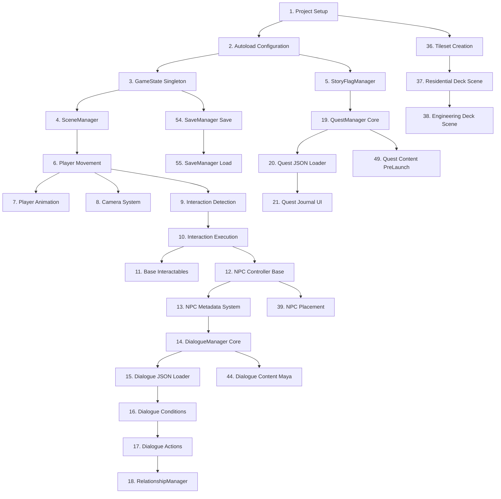

# Implementation Plan: Voyager Is Not Alone

## Overview

This document breaks down the implementation of **Voyager Is Not Alone** into actionable tasks organized by milestone. Tasks are marked as **[MVP]** for hackathon-critical features or **[FULL GAME]** for post-hackathon expansion.

**Timeline**: 6 weeks to MVP, +4 weeks to full game
**Developers**: Dev 1 (Kiro-assisted systems), Dev 2 (Dias content/environments)

**Implementation Strategy**: Foundation-first approach with parallel content development. Dev 1 builds core systems (Milestones 1-6, 9-11) while Dev 2 creates environments and content (Milestones 7-8). Critical path focuses on player movement, NPC interaction, dialogue, and quest systems to enable playable MVP.

## Task Dependency Graph

## Tasks

### Milestone 1: Foundation Systems (Week 1)
**Priority**: Critical Path - Everything depends on these foundations

- [x] 1. Project Setup and Structure [MVP]
- **Verified 2026-11-17**: `godot --headless --path . --import` and a headless run finish with no errors; main scene set to `scenes/prototype/prototype_room.tscn`.
- **Owner**: Dev 1
- **Estimated**: 2 hours
- **Dependencies**: None
- **Requirements**: REQ-1 (Game Initialization)
- **Design Reference**: Section 2 (System Architecture)
- **Description**: Initialize Godot 4.7 project, create folder hierarchy, configure version control
- **Acceptance Criteria**:
  * Godot project opens without errors
  * All required folders exist: `scenes/`, `scripts/`, `assets/`, `data/`, `tests/`
  * Git repository initialized with proper .gitignore
  * Project settings configured (resolution, stretch mode)
- **Subtasks**:
  1. Create new Godot 4.7 project
  2. Set project resolution to 640×360, stretch mode to viewport
  3. Create folder structure per design doc
  4. Initialize Git with Godot .gitignore
  5. Create README.md with project setup instructions

- [x] 1.2. Autoload Singleton Configuration [MVP]
  - **Verified 2026-11-17**: headless run prints "Ready" for all 11 autoloads and `GameState.initialize_systems()` assertions pass.
  - **Owner**: Dev 1
  - **Estimated**: 1 hour
  - **Dependencies**: 1.1
  - **Requirements**: REQ-1
  - **Design Reference**: Section 2 (System Architecture)
  - **Description**: Configure all singleton autoloads in project settings
  - **Acceptance Criteria**:
    * All 11 singletons configured in Project Settings → Autoload
    * Each singleton has placeholder script that extends Node
    * Game starts without autoload errors
    * Singletons accessible globally (e.g., `GameState`, `DialogueManager`)
  - **Subtasks**:
    1. Create `scripts/core/` directory
    2. Create placeholder scripts for: GameState, SceneManager, DialogueManager, QuestManager, RelationshipManager, StoryFlagManager, SaveManager, AudioManager, CrewTaskManager, EngineeringSimulation, PuzzleManager
    3. Configure each as autoload in project settings
    4. Add basic class_name and _ready() to each
    5. Test that all singletons initialize on game start

- [x] 1.3. GameState Singleton Implementation [MVP]
  - **Status 2026-11-20 (relationships)**: the last open criterion is verified: `start_new_game()` resets relationships, quests and story flags (`tests/integration/test_new_game_flow.gd`). All acceptance criteria met.
  - **Status 2026-11-17**: partial. Signal renamed to `new_game_started` (it clashed with the `game_started` bool).
  - **Status 2026-11-20 (quests)**: `start_new_game()` resetting quests and story flags is now verified by `tests/integration/test_new_game_flow.gd`. Relationship reset remains (3.7).
  - **Status 2026-11-17 (menu)**: verified by `tests/unit/test_game_state.gd` and `tests/integration/test_new_game_flow.gd`: name validation with player-facing errors (`get_player_name_error()`, Unicode letters allowed for RU/KZ), `start_new_game()` trims the name, sets `game_started`/chapter 1/story flags and loads `FIRST_SCENE_PATH` (prototype room for now), pause/resume/toggle. Remaining: verify that quests and relationships are reset once those managers are implemented (3.7, 4.1).
  - **Owner**: Dev 1
  - **Estimated**: 3 hours
  - **Dependencies**: 1.2
  - **Requirements**: REQ-1
  - **Design Reference**: Section 3.1 (GameState & Scene Management)
  - **Description**: Implement core GameState singleton with initialization, state tracking, and system coordination
  - **Acceptance Criteria**:
    * GameState tracks player_name, current_chapter, is_paused, game_started
    * initialize_systems() verifies all managers are loaded
    * start_new_game() resets all systems and loads first scene
    * pause_game() and resume_game() work correctly
    * All manager verification assertions pass
  - **Subtasks**:
    1. Implement player data variables (player_name, current_chapter)
    2. Implement game state flags (is_paused, game_started)
    3. Create initialize_systems() with assertions
    4. Create start_new_game(p_name: String) method
    5. Create pause_game() and resume_game() methods
    6. Add typed GDScript with strict typing
    7. Add documentation comments

- [ ] 1.4. SceneManager Singleton Implementation [MVP]
  - **Status 2026-11-17 (menu)**: partial, verified by `tests/integration/test_new_game_flow.gd`: `transition_to()` loads the new scene, frees the old one, emits started/completed once each, fade overlay (CanvasLayer 100, 0.25 s each way) ends transparent and stops blocking the mouse. Not done: player state preservation across scenes, memory-leak check, test for a missing scene path; "wipe" falls back to fade.
  - **Owner**: Dev 1
  - **Estimated**: 4 hours
  - **Dependencies**: 1.2
  - **Requirements**: REQ-1
  - **Design Reference**: Section 3.1 (GameState & Scene Management)
  - **Description**: Implement scene transition system with fade effects and state preservation
  - **Acceptance Criteria**:
    * transition_to() loads new scenes correctly
    * Fade out/in animations play smoothly
    * Previous scene is properly unloaded
    * scene_transition_started and scene_transition_completed signals emit
    * Player state preserved across transitions
    * No memory leaks when switching scenes
  - **Subtasks**:
    1. Define signals (scene_transition_started, scene_transition_completed)
    2. Implement transition_to(scene_path: String, transition_type: String)
    3. Create play_transition_out() with CanvasLayer fade
    4. Create play_transition_in() with CanvasLayer fade
    5. Add is_transitioning guard to prevent overlapping transitions
    6. Track current_scene reference
    7. Test scene loading and unloading
    8. Add error handling for missing scenes

- [ ] 1.5. StoryFlagManager Singleton Implementation [MVP]
  - **Owner**: Dev 1
  - **Estimated**: 2 hours
  - **Dependencies**: 1.2
  - **Requirements**: REQ-15 (Story Flags)
  - **Design Reference**: Section 3.5 (Story Flag System)
  - **Description**: Implement global story flag storage and retrieval with type safety
  - **Acceptance Criteria**:
    * set_flag() stores boolean flags
    * get_flag() retrieves flags with default values
    * set_value() stores typed values (int, String, float)
    * get_value() retrieves typed values with defaults
    * has_flag() checks flag existence
    * reset() clears all flags
    * flag_changed signal emits on updates
  - **Subtasks**:
    1. Create flags Dictionary for boolean flags
    2. Create values Dictionary for typed values
    3. Implement set_flag(), get_flag(), has_flag()
    4. Implement set_value(), get_value()
    5. Add flag_changed signal
    6. Create reset() method
    7. Add type validation and error messages
    8. Write unit tests for flag operations

  ---

  ## Milestone 2: Core Gameplay Systems (Week 2)
  **Priority**: Critical Path - Player must be able to move and interact

- [ ] 2.1. Player Controller - Movement [MVP]
  - **Status 2026-11-17**: partial, verified by `tests/integration/test_prototype_room.gd`: WASD/arrow bindings, 120 px/s, normalized diagonals, wall and obstacle collision, no movement while the message box is open. Not done: AnimatedSprite2D (placeholder polygons used), 60 FPS measurement. Script lives at `scripts/components/player_controller.gd` (architecture.md location) instead of `scripts/player/`.
  - **Owner**: Dev 1
  - **Estimated**: 4 hours
  - **Dependencies**: 1.1, 1.3, 1.4
  - **Requirements**: REQ-4 (Player Movement)
  - **Design Reference**: Section 3.2 (Player Controller)
  - **Description**: Implement player character movement with WASD/arrow keys at 120px/s
  - **Acceptance Criteria**:
    * Player moves in 4 directions with WASD and arrow keys
    * Movement speed is exactly 120 pixels/second
    * Diagonal movement is normalized to same speed
    * Player respects collision with walls and obstacles
    * Movement stops during dialogue/menus
    * 60 FPS maintained during movement
  - **Subtasks**:
    1. Create `scenes/player/player.tscn` with CharacterBody2D
    2. Add CollisionShape2D (circular, radius 8px)
    3. Add AnimatedSprite2D node
    4. Create `scripts/player/player_controller.gd`
    5. Implement _physics_process() input handling
    6. Implement velocity calculation with normalization
    7. Call move_and_slide() for physics movement
    8. Add collision layer/mask configuration
    9. Test movement speed with timer measurements

- [ ] 2.2. Player Controller - Animation [MVP]
  - **Owner**: Dev 1
  - **Estimated**: 3 hours
  - **Dependencies**: 2.1
  - **Requirements**: REQ-5 (Player Animation)
  - **Design Reference**: Section 3.2 (Player Controller)
  - **Description**: Implement 4-directional animations (idle, walk) for player character
  - **Acceptance Criteria**:
    * Idle animation plays when player not moving
    * Walk animation plays when player moving
    * Animation direction matches movement direction (up/down/left/right)
    * Smooth transitions between animation states
    * Animation speed matches movement speed
    * Last facing direction preserved when idle
  - **Subtasks**:
    1. Create placeholder sprite animations in AnimatedSprite2D (or wait for Dev 2 assets)
    2. Add animation state tracking (current_direction: Vector2)
    3. Implement update_animation() method
    4. Connect animation updates to movement in _physics_process()
    5. Add animation state machine logic
    6. Test all 8 animation combinations (4 directions × idle/walk)

- [ ] 2.3. Camera System [MVP]
  - **Owner**: Dev 1
  - **Estimated**: 2 hours
  - **Dependencies**: 2.1
  - **Requirements**: REQ-6 (Camera System)
  - **Design Reference**: Section 3.2 (Player Controller)
  - **Description**: Implement smooth-following camera centered on player
  - **Acceptance Criteria**:
    * Camera centered on player character
    * Camera smoothly follows with 0.1s lag
    * Camera constrains to room boundaries
    * 640×360 viewport maintained
    * Pixel-perfect rendering preserved
    * No jittering or screen tearing
  - **Subtasks**:
    1. Add Camera2D node to player scene
    2. Configure Camera2D as current camera
    3. Set position_smoothing_enabled = true
    4. Set position_smoothing_speed = 5.0
    5. Configure viewport size in project settings
    6. Test camera follow in different room sizes
    7. Add camera bounds clamping for small rooms

- [ ] 2.4. Interaction System - Detection [MVP]
  - **Status 2026-11-17**: partial, verified by test: 32 px InteractionArea, prompt "[E] Use terminal" appears in range, hides out of range and while the message box is open. Closest-object selection is implemented but not yet tested with several objects in range.
  - **Owner**: Dev 1
  - **Estimated**: 4 hours
  - **Dependencies**: 2.1
  - **Requirements**: REQ-7 (Interaction Detection)
  - **Design Reference**: Section 3.3 (Interaction System)
  - **Description**: Implement interaction detection with visual prompts
  - **Acceptance Criteria**:
    * Detects interactive objects within 32 pixels
    * Prioritizes closest object when multiple in range
    * Displays visual prompt with appropriate action text
    * Prompt updates when new object enters range
    * Prompt hides when no objects in range
    * Ignores interactions during dialogue/menus
  - **Subtasks**:
    1. Add Area2D child node to player (InteractionArea)
    2. Configure CollisionShape2D for InteractionArea (radius 32px)
    3. Create `scripts/player/interaction_system.gd`
    4. Connect area_entered and area_exited signals
    5. Track nearby_interactables array
    6. Implement get_closest_interactable() method
    7. Create interaction prompt UI (Label or Control node)
    8. Update prompt text based on object type
    9. Test with multiple objects in range

- [ ] 2.5. Interaction System - Execution [MVP]
  - **Status 2026-11-20**: NPC interaction starts dialogue and locks movement, verified by `tests/integration/test_dialogue_in_room.gd`.
  - **Status 2026-11-17**: partial, verified by test: E on a terminal opens a message box, movement is locked while it is open, E/Esc closes it, 0.2 s cooldown prevents the closing press from reopening it. Not done: NPC, door and quest-object interactions, audio feedback.
  - **Owner**: Dev 1
  - **Estimated**: 3 hours
  - **Dependencies**: 2.4
  - **Requirements**: REQ-8 (Interaction Execution)
  - **Design Reference**: Section 3.3 (Interaction System)
  - **Description**: Execute interactions with NPCs, doors, terminals, and objects
  - **Acceptance Criteria**:
    * E key triggers interaction with closest object
    * NPC interaction starts dialogue
    * Door interaction triggers scene transition
    * Terminal interaction opens terminal UI
    * Quest object interaction updates quest progress
    * Player movement disabled during interactions
    * Interactions queue properly (no double-triggers)
  - **Subtasks**:
    1. Add E key input handling in player controller
    2. Create Interactable interface/base class
    3. Implement interact() method dispatch
    4. Add interaction_started and interaction_ended signals
    5. Disable player movement during interactions
    6. Create interaction cooldown (0.2s minimum between interactions)
    7. Test with placeholder interactable objects
    8. Add audio feedback for interactions

- [ ] 2.6. Base Interactable Objects [MVP]
  - **Status 2026-11-17**: partial. Done: `Interactable` base (`scripts/components/interactable.gd`) and terminal prefab (`scenes/prefabs/terminal.tscn`) with placeholder visuals, physics layers named world/player/interactable. Not done: door and quest-object prefabs.
  - **Owner**: Dev 1
  - **Estimated**: 3 hours
  - **Dependencies**: 2.5
  - **Requirements**: REQ-7, REQ-8
  - **Design Reference**: Section 3.3 (Interaction System)
  - **Description**: Create base classes and scenes for interactable objects
  - **Acceptance Criteria**:
    * Base Interactable script with interact() method
    * DoorInteractable scene and script
    * TerminalInteractable scene and script
    * QuestObjectInteractable scene and script
    * All interactables have proper collision layers
    * All interactables emit interaction signals
    * Placeholder visuals for each type
  - **Subtasks**:
    1. Create `scripts/interaction/interactable.gd` base class
    2. Create `scenes/interaction/door.tscn` and script
    3. Create `scenes/interaction/terminal.tscn` and script
    4. Create `scenes/interaction/quest_object.tscn` and script
    5. Add interaction_type property to base class
    6. Configure collision shapes for detection
    7. Add placeholder sprites (colored rectangles)
    8. Test each interactable type with player

  ---

  ## Milestone 3: NPC and Dialogue (Week 2-3)
  **Priority**: High - Core narrative delivery system

- [ ] 3.1. NPC Controller Base [MVP]
  - **Status 2026-11-20**: partial, verified by `tests/integration/test_dialogue_in_room.gd` and `tests/content/test_dialogue_content.gd`: `scenes/npcs/npc_base.tscn` + `scripts/components/npc_controller.gd` (CharacterBody2D with collision, composes an `Interactable` child instead of inheriting it), `npc_id`/`display_name` from metadata, prompt "[E] Talk to <name>", E starts the NPC's dialogue. Not done: AnimatedSprite2D and idle animation (placeholder polygons); `face_towards()` exists but is not tested.
  - **Owner**: Dev 1
  - **Estimated**: 4 hours
  - **Dependencies**: 2.1
  - **Requirements**: REQ-11 (NPC Presence)
  - **Design Reference**: Section 3.4 (NPC System)
  - **Description**: Create base NPC controller with idle behavior and interaction support
  - **Acceptance Criteria**:
    * NPCs have CharacterBody2D with collision
    * NPCs have AnimatedSprite2D for visuals
    * NPCs are interactable (inherit from Interactable)
    * NPCs have npc_id, display_name properties
    * NPCs can face player when interacting
    * NPCs have idle animation state
    * NPCs load metadata from JSON
  - **Subtasks**:
    1. Create `scenes/npcs/npc_base.tscn`
    2. Create `scripts/npcs/npc_controller.gd`
    3. Add CharacterBody2D with CollisionShape2D
    4. Add AnimatedSprite2D
    5. Make NPCs interactable (add to Interactable group)
    6. Implement interact() to trigger dialogue
    7. Add look_at_player() method
    8. Load NPC metadata from JSON on _ready()
    9. Test with placeholder NPC

- [ ] 3.2. NPC Metadata System [MVP]
  - **Status 2026-11-20**: partial. `NpcRegistry` loads and caches `data/npcs/<npc_id>.json` (design.md 4.3 subset: npc_id, display_name, role, description, dialogue_files, initial_relationships); missing files fall back to a readable name; parse errors give file and line; validated by the content check. Only `elias_voss.json` exists. Not done: metadata for Maya, Nora, Daniel; initial_position/spawn data; initial_relationships is stored but not read yet (3.7).
  - **Owner**: Dev 1
  - **Estimated**: 2 hours
  - **Dependencies**: 3.1
  - **Requirements**: REQ-11
  - **Design Reference**: Section 4.2 (NPC Metadata Schema)
  - **Description**: Implement JSON loading for NPC metadata
  - **Acceptance Criteria**:
    * NPCs load data from `data/npcs/[npc_id].json`
    * Metadata includes display_name, description, initial_position
    * Metadata includes trust/bond starting values
    * Metadata includes dialogue_tree reference
    * Missing metadata handled gracefully with defaults
    * JSON parsing errors logged clearly
  - **Subtasks**:
    1. Create NPC metadata JSON schema
    2. Create sample metadata file: `data/npcs/maya_chen.json`
    3. Implement load_metadata(npc_id: String) in NPC controller
    4. Parse JSON and populate NPC properties
    5. Add error handling for missing/invalid files
    6. Create metadata for all 4 crew members
    7. Test loading all crew member metadata

- [x] 3.3. DialogueManager Singleton - Core [MVP]
  - **Status 2026-11-20**: acceptance criteria verified by `tests/unit/test_dialogue_manager.gd` (48 checks) and `tests/integration/test_dialogue_in_room.gd` (34 checks). API is `start_dialogue(dialogue_path, npc_id)` as in design.md 3.5, not `start_dialogue(npc_id)`. Dialogue box lives in the HUD (`scripts/ui/dialogue_box.gd`) with a typewriter effect, E/Enter to skip or continue, arrow keys between choices. Not done: subtask 10 (slide in/out animation).
  - **Owner**: Dev 1
  - **Estimated**: 6 hours
  - **Dependencies**: 1.2, 3.1
  - **Requirements**: REQ-12 (Dialogue System)
  - **Design Reference**: Section 3.4.2 (Dialogue System)
  - **Description**: Implement core dialogue system with tree traversal and UI
  - **Acceptance Criteria**:
    * start_dialogue(npc_id: String) loads and displays dialogue
    * Dialogue nodes display speaker name and text
    * Player choices displayed as buttons
    * Selecting choice advances to next node
    * END node closes dialogue
    * dialogue_started and dialogue_ended signals emit
    * Player movement disabled during dialogue
  - **Subtasks**:
    1. Create dialogue data structures (DialogueNode class)
    2. Implement load_dialogue_tree(tree_id: String) from JSON
    3. Create `scenes/ui/dialogue_box.tscn`
    4. Add Label for speaker name
    5. Add Label for dialogue text
    6. Add Container for choice buttons
    7. Implement start_dialogue() method
    8. Implement display_node(node_id: String) method
    9. Implement choice selection and traversal
    10. Add dialogue box animations (slide in/out)
    11. Test with sample dialogue tree

- [ ] 3.4. Dialogue JSON Loader [MVP]
  - **Status 2026-11-20**: partial, verified by the unit and content tests: loads from `data/dialogues/`, validates structure and every node reference, rejects unknown fields, caches trees (`clear_cache()` forces a reload), errors name file and line. The format follows design.md 3.5 (fields such as responses/next_node/conditions) rather than the TEXT/CHOICE/BRANCH/ACTION/END node types listed here; documented in `docs/dialogue-format.md`. Not done: automatic hot-reload while the game runs.
  - **Owner**: Dev 1
  - **Estimated**: 3 hours
  - **Dependencies**: 3.3
  - **Requirements**: REQ-12
  - **Design Reference**: Section 4.1 (Dialogue Tree Schema)
  - **Description**: Load and parse dialogue trees from JSON files
  - **Acceptance Criteria**:
    * Loads dialogue from `data/dialogues/[tree_id].json`
    * Parses all node types (TEXT, CHOICE, BRANCH, ACTION, END)
    * Handles missing nodes with error messages
    * Validates JSON structure on load
    * Caches loaded trees to avoid re-parsing
    * Supports hot-reloading during development
  - **Subtasks**:
    1. Create dialogue tree JSON schema documentation
    2. Implement load_dialogue_tree() with FileAccess
    3. Parse JSON into DialogueNode objects
    4. Validate tree structure (all references valid)
    5. Add dialogue_tree_cache Dictionary
    6. Implement error handling for malformed JSON
    7. Create sample dialogue tree for testing
    8. Test loading multiple dialogue trees

- [ ] 3.5. Dialogue Conditions and Branching [MVP]
  - **Status 2026-11-20 (relationships)**: relationship conditions (`relationships: [{npc_id, type, min, max}]`) added; verified in both directions (theory choice shown at trust 60, hidden at 40). All condition types from the criteria now exist. Still missing: debug logging of condition results.
  - **Status 2026-11-20 (quests)**: quest status conditions (`quests: [{quest_id, status}]`) added and covered by the quest integration test. Still missing: relationship conditions, debug logging.
  - **Status 2026-11-20**: partial, verified by tests: story-flag conditions on nodes and on choices, AND logic, `fallback_node` when a node's conditions fail, loop protection. Not done: relationship conditions (needs 3.7), quest conditions (needs 4.1), debug logging of condition results; the validator rejects these keys until then.
  - **Owner**: Dev 1
  - **Estimated**: 4 hours
  - **Dependencies**: 3.4, 1.5
  - **Requirements**: REQ-13 (Branching Dialogue)
  - **Design Reference**: Section 3.4.2 (Dialogue System)
  - **Description**: Implement conditional branching based on story flags and relationships
  - **Acceptance Criteria**:
    * BRANCH nodes evaluate conditions correctly
    * Supports story flag conditions (flag_set, flag_not_set)
    * Supports relationship conditions (trust_gte, bond_gte)
    * Supports quest conditions (quest_completed, quest_active)
    * Multiple conditions evaluated with AND logic
    * Falls back to default branch if no conditions met
    * Conditions logged for debugging
  - **Subtasks**:
    1. Create Condition class with type and parameters
    2. Implement evaluate_condition(condition: Condition) method
    3. Add support for story flag conditions
    4. Add support for relationship conditions
    5. Add support for quest conditions
    6. Implement evaluate_branch_node(node: DialogueNode) method
    7. Add condition debugging logs
    8. Create test dialogue with multiple branches
    9. Test all condition types

- [ ] 3.6. Dialogue Actions and Side Effects [MVP]
  - **Status 2026-11-20 (relationships)**: partial. Done and tested: set_flag, change_relationship, start_quest and update_quest (completes an objective; completing all required objectives completes the quest), run in JSON order. The format uses `effects` on nodes and responses (design.md 3.5), not separate ACTION nodes. Not done: give_item (no inventory), action logging.
  - **Owner**: Dev 1
  - **Estimated**: 4 hours
  - **Dependencies**: 3.5
  - **Requirements**: REQ-12
  - **Design Reference**: Section 3.4.2 (Dialogue System)
  - **Description**: Execute actions triggered by dialogue (set flags, modify relationships, start quests)
  - **Acceptance Criteria**:
    * ACTION nodes execute without displaying to player
    * set_flag action sets story flags
    * modify_relationship action changes trust/bond
    * start_quest action initiates quests
    * complete_quest action marks quests complete
    * give_item action adds items to inventory (if implemented)
    * Actions execute in order defined in JSON
    * Action execution logged for debugging
  - **Subtasks**:
    1. Create Action class with type and parameters
    2. Implement execute_action(action: Action) method
    3. Add set_flag action handler
    4. Add modify_relationship action handler
    5. Add start_quest action handler
    6. Add complete_quest action handler
    7. Connect actions to manager singletons
    8. Add action execution logging
    9. Create test dialogue with multiple actions
    10. Test all action types

- [x] 3.7. RelationshipManager Singleton [MVP]
  - **Status 2026-11-20 (relationships)**: verified by `tests/unit/test_relationship_manager.gd` (50 checks) and the quest/dialogue room tests. Deviation: trust uses 0..100 like bond, not -100..100, following requirements.md REQ-22 and design.md 3.7 (this task's range conflicted with both). Starting values come from `initial_relationships` in `data/npcs/<id>.json` (Elias 40/50, others 50/50). `modify_trust()`/`modify_bond()` return the applied change; `relationship_changed(npc_id, type, old, new)` fires only on real changes; `get_relationship_status()` adds the design.md tiers. Also done: dialogue condition `relationships` and effect `change_relationship`, quest prerequisites and rewards, HUD notice "Elias Voss: Trust +5" (REQ-24.1-2). Not done: relationships screen (REQ-24.3-6).
  - **Owner**: Dev 1
  - **Estimated**: 3 hours
  - **Dependencies**: 1.2, 3.1
  - **Requirements**: REQ-14 (Relationship System)
  - **Design Reference**: Section 3.4.3 (Relationship System)
  - **Description**: Track trust and bond values for all crew members
  - **Acceptance Criteria**:
    * Tracks trust (-100 to 100) for each crew member
    * Tracks bond (0 to 100) for each crew member
    * modify_trust() changes trust values
    * modify_bond() changes bond values
    * Values clamped to valid ranges
    * relationship_changed signal emits on changes
    * get_relationship_status() returns current values
    * reset() initializes all relationships
  - **Subtasks**:
    1. Create relationships Dictionary (npc_id → {trust, bond})
    2. Implement modify_trust(npc_id: String, amount: int)
    3. Implement modify_bond(npc_id: String, amount: int)
    4. Add value clamping (-100 to 100 for trust, 0 to 100 for bond)
    5. Add relationship_changed signal with parameters
    6. Implement get_trust() and get_bond() getters
    7. Create reset() to initialize all crew relationships
    8. Add relationship logging for debugging
    9. Write unit tests for relationship calculations

  ---

  ## Milestone 4: Quest and Story Systems (Week 3)
  **Priority**: High - Drives player progression and narrative

- [x] 4.1. QuestManager Singleton - Core [MVP]
  - **Status 2026-11-20 (quests)**: verified by `tests/unit/test_quest_manager.gd` (57 checks): states not_started/active/completed/failed, objectives tracked individually, signals quest_started/quest_updated/objective_completed/quest_completed/quest_failed, `get_active_quests()`, `fail_quest()`. API differs from the criteria: objectives advance with `complete_objective(quest_id, objective_id)`, and a quest completes automatically when its required objectives are done (no public `complete_quest()`). Runtime state is kept apart from JSON definitions, ready for save/load.
  - **Owner**: Dev 1
  - **Estimated**: 5 hours
  - **Dependencies**: 1.2, 1.5
  - **Requirements**: REQ-16 (Quest System)
  - **Design Reference**: Section 3.5 (Quest System)
  - **Description**: Implement quest tracking with states, objectives, and progression
  - **Acceptance Criteria**:
    * start_quest(quest_id) initializes quest from JSON
    * Quests have states: NOT_STARTED, ACTIVE, COMPLETED, FAILED
    * Objectives tracked individually with completion status
    * update_objective() advances quest progress
    * complete_quest() marks quest done
    * quest_started, quest_updated, quest_completed signals emit
    * get_active_quests() returns list of active quests
  - **Subtasks**:
    1. Create Quest class with id, title, objectives, state
    2. Create Objective class with id, description, completed
    3. Implement active_quests Dictionary
    4. Implement start_quest(quest_id: String)
    5. Load quest data from JSON
    6. Implement update_objective(quest_id, objective_id)
    7. Implement complete_quest(quest_id)
    8. Add all quest-related signals
    9. Create get_active_quests() and get_quest_state()
    10. Write unit tests for quest state transitions

- [x] 4.2. Quest JSON Loader [MVP]
  - **Status 2026-11-20 (quests)**: verified by unit and content tests: loads `data/quests/<quest_id>.json`, validates structure (unknown fields, objective types, ids), missing/invalid files give clear errors, prerequisites (story_flags, quests_completed), cache with `clear_cache()`. Schema documented in `docs/quest-format.md`. One game quest (`ch1_main_borrowed_power`) plus three test fixtures. Supported subset: objective types story_flag and talk_to, rewards story_flags; other design.md fields are rejected until their systems exist.
  - **Owner**: Dev 1
  - **Estimated**: 3 hours
  - **Dependencies**: 4.1
  - **Requirements**: REQ-16
  - **Design Reference**: Section 4.3 (Quest Schema)
  - **Description**: Load quest definitions from JSON files
  - **Acceptance Criteria**:
    * Loads quests from `data/quests/[quest_id].json`
    * Parses quest metadata, objectives, rewards
    * Validates quest structure on load
    * Handles missing quest files gracefully
    * Supports quest prerequisites
    * Caches loaded quest definitions
  - **Subtasks**:
    1. Create quest JSON schema documentation
    2. Implement load_quest_definition(quest_id: String)
    3. Parse JSON into Quest object
    4. Add quest_definitions cache Dictionary
    5. Implement prerequisite checking
    6. Add error handling for invalid quests
    7. Create sample quest JSON files (at least 2)
    8. Test loading and starting quests

- [ ] 4.3. Quest Journal UI [MVP]
  - **Status 2026-11-20 (quests)**: partial. Done: HUD quest tracker (`scripts/ui/quest_tracker.gd`) lists active quests with [ ]/[x] objectives, updates live, shows COMPLETE for 4 s, fades while the player stands behind it; verified by `tests/integration/test_quest_in_room.gd`. Not done: the Tab journal with Active/Completed sections and descriptions.
  - **Owner**: Dev 1
  - **Estimated**: 4 hours
  - **Dependencies**: 4.1
  - **Requirements**: REQ-18 (Quest Journal)
  - **Design Reference**: Section 5.3 (Quest Journal UI)
  - **Description**: Create quest journal UI to display active and completed quests
  - **Acceptance Criteria**:
    * Journal accessible via Tab key
    * Lists all active quests
    * Shows quest objectives with completion checkmarks
    * Displays quest descriptions
    * Shows completed quests in separate section
    * Updates in real-time when quests change
    * Can be closed with Tab or Escape
  - **Subtasks**:
    1. Create `scenes/ui/quest_journal.tscn`
    2. Add TabContainer for Active/Completed tabs
    3. Create quest list ItemList or VBoxContainer
    4. Create quest detail panel with RichTextLabel
    5. Implement open_journal() and close_journal()
    6. Connect to QuestManager signals for updates
    7. Implement quest selection to show details
    8. Add objective checkboxes/checkmarks
    9. Style journal with theme
    10. Test with multiple active quests

- [ ] 4.4. Quest Integration with Interactions [MVP]
  - **Status 2026-11-20 (quests)**: partial, verified by `tests/integration/test_quest_in_room.gd` with real input: Elias gives the quest (dialogue effect `start_quest`), reading the terminal completes a story_flag objective, the report line completes the talk_to objective (`update_quest`), the quest completes and sets its reward flag. Not done: progress across scene changes (QuestManager is an autoload, but no second scene exists to test it); QuestObjectInteractable prefab (terminals drive objectives through story flags instead).
  - **Owner**: Dev 1
  - **Estimated**: 2 hours
  - **Dependencies**: 4.1, 2.6
  - **Requirements**: REQ-16
  - **Design Reference**: Section 3.5 (Quest System)
  - **Description**: Connect quest objectives to world interactions
  - **Acceptance Criteria**:
    * Quest objects update objectives when interacted with
    * Dialogue choices can complete objectives
    * NPCs can give and complete quests
    * Quest progress persists across scenes
    * Quest completion triggers rewards/flags
  - **Subtasks**:
    1. Add quest_objective_id property to QuestObjectInteractable
    2. Connect interact() to QuestManager.update_objective()
    3. Add quest action support in dialogue system
    4. Test quest progression through interactions
    5. Test quest completion flow

  ---

  ## Milestone 5: Engineering and Resources (Week 3-4)
  **Priority**: Medium-High - Core to game theme but can be simplified for MVP

- [ ] 5.1. ResourceManager Singleton [MVP]
  - **Owner**: Dev 1
  - **Estimated**: 3 hours
  - **Dependencies**: 1.2
  - **Requirements**: REQ-31 (Resource System)
  - **Design Reference**: Section 3.6.3 (Resource Management)
  - **Description**: Track spacecraft resources (power, fuel, oxygen, supplies)
  - **Acceptance Criteria**:
    * Tracks power, fuel, oxygen, supplies as floats
    * modify_resource() changes resource values
    * get_resource() returns current value
    * resource_changed signal emits on updates
    * Resources clamped to 0.0 - max values
    * reset() initializes default resource levels
    * Supports resource consumption over time
  - **Subtasks**:
    1. Create resources Dictionary (resource_name → current/max)
    2. Implement modify_resource(name: String, amount: float)
    3. Implement get_resource(name: String) → float
    4. Add resource_changed signal
    5. Add value clamping
    6. Create reset() with default values
    7. Implement _process() for continuous consumption
    8. Add resource warning thresholds
    9. Write unit tests for resource operations

- [ ] 5.2. EngineeringSimulation Singleton - Basic [MVP]
  - **Owner**: Dev 1
  - **Estimated**: 5 hours
  - **Dependencies**: 5.1
  - **Requirements**: REQ-32 (Engineering Simulation)
  - **Design Reference**: Section 3.6.1 (Engineering Simulation)
  - **Description**: Basic physics calculations for velocity, trajectory, delta-v
  - **Acceptance Criteria**:
    * calculate_delta_v() returns delta-v for maneuvers
    * calculate_trajectory() computes orbital trajectory
    * calculate_travel_time() estimates journey duration
    * Calculations use realistic physics constants
    * Results displayed with appropriate precision
    * Calculations complete within 16ms (60 FPS)
  - **Subtasks**:
    1. Define physics constants (G, c, AU, etc.)
    2. Implement calculate_delta_v(mass, exhaust_velocity, fuel_mass)
    3. Implement calculate_trajectory(position, velocity, target)
    4. Implement calculate_travel_time(distance, acceleration)
    5. Add result caching for expensive calculations
    6. Create calculation validation tests
    7. Add calculation logging for debugging

- [ ] 5.3. CrewTaskManager Singleton [MVP]
  - **Owner**: Dev 1
  - **Estimated**: 4 hours
  - **Dependencies**: 1.2, 3.7
  - **Requirements**: REQ-33 (Crew Management)
  - **Design Reference**: Section 3.6.2 (Crew Management)
  - **Description**: Assign crew members to tasks with duration, fatigue, and skill checks
  - **Acceptance Criteria**:
    * assign_task(crew_id, task_id) starts task
    * Tasks have duration, skill requirements, fatigue cost
    * Crew members have skill levels and fatigue
    * Tasks complete after duration elapses
    * task_started, task_completed signals emit
    * get_crew_status() returns availability and fatigue
    * Crew can rest to reduce fatigue
  - **Subtasks**:
    1. Create CrewMember class with skills and fatigue
    2. Create Task class with duration, requirements, effects
    3. Implement assign_task(crew_id: String, task_id: String)
    4. Add task timer tracking in _process()
    5. Implement skill check validation
    6. Add fatigue accumulation
    7. Implement rest_crew() to reduce fatigue
    8. Add task-related signals
    9. Create sample tasks JSON
    10. Test task assignment and completion

- [ ] 5.4. Engineering UI - Ship Status [MVP]
  - **Owner**: Dev 1
  - **Estimated**: 4 hours
  - **Dependencies**: 5.1, 5.2
  - **Requirements**: REQ-34 (Ship Systems Interface)
  - **Design Reference**: Section 5.5 (Ship Systems Interface)
  - **Description**: Display ship resources, systems status, and engineering calculations
  - **Acceptance Criteria**:
    * Shows power, fuel, oxygen, supplies with progress bars
    * Displays current velocity and trajectory
    * Shows crew assignments and status
    * Updates in real-time as resources change
    * Accessible via dedicated UI key (e.g., I)
    * Can be closed with same key or Escape
  - **Subtasks**:
    1. Create `scenes/ui/ship_status.tscn`
    2. Add resource display with ProgressBars
    3. Add systems status indicators
    4. Add crew status panel
    5. Connect to ResourceManager and CrewTaskManager signals
    6. Implement open/close toggle
    7. Style with theme
    8. Test real-time updates

- [ ] 5.5. Engineering Calculation UI [MVP]
  - **Owner**: Dev 1
  - **Estimated**: 3 hours
  - **Dependencies**: 5.2, 5.4
  - **Requirements**: REQ-32
  - **Design Reference**: Section 5.5 (Ship Systems Interface)
  - **Description**: UI for performing trajectory calculations and flight planning
  - **Acceptance Criteria**:
    * Input fields for calculation parameters
    * Calculate button triggers simulations
    * Results displayed with units and precision
    * Can save calculation results
    * Shows warnings for insufficient resources
    * Accessible from ship status UI
  - **Subtasks**:
    1. Add calculation panel to ship_status.tscn
    2. Create input fields (LineEdit/SpinBox)
    3. Add calculation type selector (OptionButton)
    4. Implement calculate_button pressed handler
    5. Display results in RichTextLabel
    6. Add result validation and warnings
    7. Test various calculation scenarios

  ---

  ## Milestone 6: Puzzle System (Week 4)
  **Priority**: Medium - Key gameplay variety but can be simplified

- [ ] 6.1. PuzzleManager Singleton [MVP]
  - **Owner**: Dev 1
  - **Estimated**: 3 hours
  - **Dependencies**: 1.2, 1.5
  - **Requirements**: REQ-37 (Puzzle System)
  - **Design Reference**: Section 3.7 (Puzzle System)
  - **Description**: Manage puzzle state, validation, and completion
  - **Acceptance Criteria**:
    * start_puzzle(puzzle_id) loads puzzle from JSON
    * validate_solution(puzzle_id, solution) checks correctness
    * Puzzles have states: NOT_STARTED, IN_PROGRESS, COMPLETED
    * puzzle_started, puzzle_completed, puzzle_failed signals emit
    * Failed attempts tracked with optional retry limits
    * Completed puzzles set story flags
  - **Subtasks**:
    1. Create Puzzle class with id, type, solution, state
    2. Implement active_puzzles Dictionary
    3. Implement start_puzzle(puzzle_id: String)
    4. Load puzzle definitions from JSON
    5. Implement validate_solution(puzzle_id, solution)
    6. Add puzzle state tracking
    7. Add puzzle-related signals
    8. Create reset_puzzle() method
    9. Write validation unit tests

- [ ] 6.2. Power Grid Puzzle - Logic [MVP]
  - **Owner**: Dev 1
  - **Estimated**: 5 hours
  - **Dependencies**: 6.1
  - **Requirements**: REQ-38 (Power Grid Puzzle)
  - **Design Reference**: Section 3.7.1 (Power Grid Puzzle), Section 4.4 (Puzzle Schema)
  - **Description**: Implement power routing puzzle with generator, cables, and distribution
  - **Acceptance Criteria**:
    * Grid has cells with generators, cables, consumers
    * Players can place/rotate cables
    * Power flows from generators through cables
    * Solution validation checks all consumers powered
    * Multiple valid solutions possible
    * Grid state saved between sessions
    * Puzzle completion triggers story flag
  - **Subtasks**:
    1. Create PowerGridPuzzle class extending Puzzle
    2. Define grid as 2D array of cells
    3. Implement power flow algorithm
    4. Create cable rotation logic
    5. Implement validate_power_grid() solution check
    6. Add hint system (optional)
    7. Create sample power grid puzzle JSON
    8. Test puzzle with multiple solutions
    9. Test edge cases (no solution, incomplete grid)

- [ ] 6.3. Power Grid Puzzle - UI [MVP]
  - **Owner**: Dev 1
  - **Estimated**: 5 hours
  - **Dependencies**: 6.2
  - **Requirements**: REQ-38
  - **Design Reference**: Section 3.7.1 (Power Grid Puzzle)
  - **Description**: Interactive UI for power grid puzzle
  - **Acceptance Criteria**:
    * Displays grid with generators, cables, consumers
    * Click cells to place cables
    * Right-click to rotate cables
    * Visual feedback for powered vs unpowered cells
    * Submit button to check solution
    * Reset button to clear player changes
    * Instructions panel explaining puzzle
    * Close button to exit (saves progress)
  - **Subtasks**:
    1. Create `scenes/puzzles/power_grid_puzzle.tscn`
    2. Create GridContainer for puzzle cells
    3. Create cell sprites (generator, cable types, consumer)
    4. Implement cell click handlers
    5. Implement cable rotation on right-click
    6. Add visual indicators for power flow
    7. Create submit/reset/close buttons
    8. Add instructions text
    9. Connect to PuzzleManager for validation
    10. Test puzzle UI interaction flow

- [ ] 6.4. Signal Analysis Puzzle - Logic [MVP]
  - **Owner**: Dev 1
  - **Estimated**: 4 hours
  - **Dependencies**: 6.1
  - **Requirements**: REQ-39 (Signal Analysis Puzzle)
  - **Design Reference**: Section 3.7.2 (Signal Analysis Puzzle)
  - **Description**: Implement signal pattern matching puzzle
  - **Acceptance Criteria**:
    * Signal has amplitude, frequency, phase properties
    * Players adjust filter parameters
    * Validation checks if filtered signal matches target pattern
    * Tolerance-based matching (not exact)
    * Hints available showing signal visualization
    * Multiple valid parameter combinations possible
  - **Subtasks**:
    1. Create SignalAnalysisPuzzle class extending Puzzle
    2. Define signal properties and filter parameters
    3. Implement filter algorithm (basic FFT or pattern match)
    4. Implement validate_signal_match(params) with tolerance
    5. Create sample signal puzzle JSON
    6. Add hint generation logic
    7. Test puzzle with various parameter combinations

- [ ] 6.5. Signal Analysis Puzzle - UI [MVP]
  - **Owner**: Dev 1
  - **Estimated**: 4 hours
  - **Dependencies**: 6.4
  - **Requirements**: REQ-39
  - **Design Reference**: Section 3.7.2 (Signal Analysis Puzzle)
  - **Description**: Interactive UI for signal analysis puzzle
  - **Acceptance Criteria**:
    * Displays signal waveform visualization
    * Sliders for adjusting filter parameters
    * Real-time preview of filtered signal
    * Match percentage displayed
    * Submit button to check solution
    * Reset button to restore defaults
    * Instructions and hints panel
  - **Subtasks**:
    1. Create `scenes/puzzles/signal_puzzle.tscn`
    2. Add signal visualization (Line2D or custom draw)
    3. Create parameter adjustment sliders
    4. Implement real-time signal preview
    5. Add match percentage calculation
    6. Create submit/reset buttons
    7. Add instructions panel
    8. Connect to PuzzleManager
    9. Test puzzle UI and visualization

  ---

  ## Milestone 7: Environment Content (Week 2-4 Parallel - Dev 2)
  **Priority**: High - Essential for MVP playable space

- [ ] 7.1. Tileset Creation [MVP]
  - **Owner**: Dev 2
  - **Estimated**: 8 hours
  - **Dependencies**: 1.1
  - **Requirements**: REQ-9, REQ-10
  - **Design Reference**: Section 6 (Art and Asset Guidelines)
  - **Description**: Create pixel art tileset for station environments
  - **Acceptance Criteria**:
    * Floor tiles (metal plating, grating)
    * Wall tiles (horizontal, vertical, corners)
    * Door tiles (closed, open states)
    * Window tiles (viewports to space)
    * Decoration tiles (panels, lights, vents)
    * Consistent 16×16 or 32×32 tile size
    * Cohesive color palette
    * All tiles have collision data defined
  - **Subtasks**:
    1. Design color palette for station aesthetic
    2. Create floor tile variations
    3. Create wall tile set with autotiling
    4. Create door tiles with animation frames
    5. Create window and decoration tiles
    6. Import tiles into Godot TileSet resource
    7. Configure collision shapes for solid tiles
    8. Test tileset in sample scene

- [ ] 7.2. Residential Deck - Scene Setup [MVP]
  - **Owner**: Dev 2
  - **Estimated**: 6 hours
  - **Dependencies**: 7.1, 2.1
  - **Requirements**: REQ-9, REQ-10
  - **Design Reference**: Section 9 (Chapter 1 MVP Scope)
  - **Description**: Build residential deck layout with crew quarters, common area, galley
  - **Acceptance Criteria**:
    * Scene file: `scenes/environments/station/residential_deck_01.tscn`
    * Contains 5-7 rooms with corridors
    * Crew quarters for all 4 crew members
    * Common area with seating
    * Galley with tables
    * Elevator/stairs to other floors
    * All rooms connected with doors
    * Collision boundaries properly set
  - **Subtasks**:
    1. Create new scene with TileMapLayer
    2. Layout floor plan for residential deck
    3. Paint floor and wall tiles
    4. Add room dividers and corridors
    5. Place door objects at transitions
    6. Add decoration tiles
    7. Add lighting effects (if applicable)
    8. Test player navigation through all rooms
    9. Add spawn points for NPCs

- [ ] 7.3. Engineering Deck - Scene Setup [MVP]
  - **Owner**: Dev 2
  - **Estimated**: 5 hours
  - **Dependencies**: 7.1, 7.2
  - **Requirements**: REQ-9, REQ-10
  - **Design Reference**: Section 9 (Chapter 1 MVP Scope)
  - **Description**: Build engineering deck with reactor room, workshop, equipment bay
  - **Acceptance Criteria**:
    * Scene file: `scenes/environments/station/engineering_deck_01.tscn`
    * Contains reactor room, workshop, equipment bay
    * Hazard areas marked visually
    * Terminals placed for interaction
    * Connected to residential deck via elevator
    * Atmosphere distinct from residential (industrial)
  - **Subtasks**:
    1. Create new scene with TileMapLayer
    2. Layout floor plan for engineering deck
    3. Paint floor and wall tiles
    4. Add large equipment placeholders
    5. Place terminal objects
    6. Add power conduits and piping decoration
    7. Add warning stripes and hazard markers
    8. Connect elevator to residential deck
    9. Test scene transitions

- [ ] 7.4. NPC Placement and Spawn Points [MVP]
  - **Owner**: Dev 2
  - **Estimated**: 2 hours
  - **Dependencies**: 7.2, 7.3, 3.1
  - **Requirements**: REQ-11
  - **Design Reference**: Section 4.2 (NPC Metadata)
  - **Description**: Place NPC instances in scenes at appropriate starting locations
  - **Acceptance Criteria**:
    * Maya Chen in navigation area
    * Elias Voss in engineering workshop
    * Nora Reyes in lab/common area
    * Daniel Kim in medical bay or quarters
    * Each NPC has unique npc_id set
    * NPC positions match their roles
    * NPCs don't block doorways or corridors
  - **Subtasks**:
    1. Instantiate npc_base.tscn in residential deck
    2. Set npc_id for each instance
    3. Position NPCs appropriately
    4. Test NPC interaction accessibility
    5. Add NPCs to engineering deck
    6. Test scene loading with NPCs present

- [ ] 7.5. Door Setup and Scene Transitions [MVP]
  - **Owner**: Dev 2
  - **Estimated**: 3 hours
  - **Dependencies**: 7.2, 7.3, 2.6
  - **Requirements**: REQ-10
  - **Design Reference**: Section 3.3 (Interaction System)
  - **Description**: Configure all door objects with proper scene transition targets
  - **Acceptance Criteria**:
    * Each door has target_scene property set
    * Doors transition to correct scenes
    * Doors have proper interaction prompts
    * Locked doors show locked state (if applicable)
    * Elevator doors connect floors correctly
    * Player spawns at correct position after transition
  - **Subtasks**:
    1. Review all door placements
    2. Set target_scene for each door instance
    3. Set player spawn positions in target scenes
    4. Test all door transitions
    5. Add door open/close animations (optional)
    6. Label doors for debugging (room names)

- [ ] 7.6. Environmental Storytelling [MVP]
  - **Owner**: Dev 2
  - **Estimated**: 4 hours
  - **Dependencies**: 7.2, 7.3
  - **Requirements**: REQ-10
  - **Design Reference**: Section 6 (Art and Asset Guidelines)
  - **Description**: Add environmental details that tell story without dialogue
  - **Acceptance Criteria**:
    * Personal items in crew quarters
    * Posters, notes, screens showing info
    * Maintenance signs and warnings
    * Clutter showing station is lived-in
    * Visual hints about crew personalities
    * Details support overall narrative tone
  - **Subtasks**:
    1. Add personal items to crew quarters
    2. Place readable notes/terminals with lore
    3. Add mission briefing posters
    4. Add equipment labels and warnings
    5. Add subtle worn/damaged elements
    6. Review environmental storytelling coherence

  ---

  ## Milestone 8: Content Creation (Week 3-5 Parallel - Dev 2)
  **Priority**: High - Core narrative content

- [ ] 8.1. Dialogue Content - Maya Chen [MVP]
  - **Owner**: Dev 2
  - **Estimated**: 4 hours
  - **Dependencies**: 3.4
  - **Requirements**: REQ-12, REQ-13
  - **Design Reference**: Section 4.1 (Dialogue Schema)
  - **Description**: Write dialogue tree for navigator Maya Chen
  - **Acceptance Criteria**:
    * Initial introduction dialogue
    * At least 3 conversation topics
    * At least 2 branching paths based on player choices
    * Professional but warm personality
    * References astrodynamics and navigation
    * At least one quest hook
    * File: `data/dialogues/maya_chen_intro.json`
  - **Subtasks**:
    1. Outline Maya's personality and speech patterns
    2. Write introduction dialogue sequence
    3. Create conversation topics (navigation, mission, personal)
    4. Add player response options
    5. Add branching based on relationship level
    6. Format as JSON following schema
    7. Test dialogue in-game
    8. Revise based on pacing

- [ ] 8.2. Dialogue Content - Elias Voss [MVP]
  - **Owner**: Dev 2
  - **Estimated**: 4 hours
  - **Dependencies**: 3.4
  - **Requirements**: REQ-12, REQ-13
  - **Design Reference**: Section 4.1 (Dialogue Schema)
  - **Description**: Write dialogue tree for engineer Elias Voss
  - **Acceptance Criteria**:
    * Initial introduction dialogue
    * At least 3 conversation topics
    * At least 2 branching paths
    * Gruff but dedicated personality
    * References propulsion and engineering
    * At least one quest hook
    * File: `data/dialogues/elias_voss_intro.json`
  - **Subtasks**:
    1. Outline Elias's personality and speech patterns
    2. Write introduction dialogue sequence
    3. Create conversation topics (engineering, ship status, personal)
    4. Add player response options with personality
    5. Add trust-based dialogue variations
    6. Format as JSON following schema
    7. Test dialogue in-game
    8. Revise based on characterization

- [ ] 8.3. Dialogue Content - Nora Reyes [MVP]
  - **Owner**: Dev 2
  - **Estimated**: 4 hours
  - **Dependencies**: 3.4
  - **Requirements**: REQ-12, REQ-13
  - **Design Reference**: Section 4.1 (Dialogue Schema)
  - **Description**: Write dialogue tree for astrobiologist Nora Reyes
  - **Acceptance Criteria**:
    * Initial introduction dialogue
    * At least 3 conversation topics
    * At least 2 branching paths
    * Curious and optimistic personality
    * References biology and life detection
    * At least one quest hook
    * File: `data/dialogues/nora_reyes_intro.json`
  - **Subtasks**:
    1. Outline Nora's personality and speech patterns
    2. Write introduction dialogue sequence
    3. Create conversation topics (exobiology, mission goals, personal)
    4. Add enthusiastic response options
    5. Add bond-based dialogue variations
    6. Format as JSON following schema
    7. Test dialogue in-game
    8. Revise for voice consistency

- [ ] 8.4. Dialogue Content - Daniel Kim [MVP]
  - **Owner**: Dev 2
  - **Estimated**: 4 hours
  - **Dependencies**: 3.4
  - **Requirements**: REQ-12, REQ-13
  - **Design Reference**: Section 4.1 (Dialogue Schema)
  - **Description**: Write dialogue tree for doctor Daniel Kim
  - **Acceptance Criteria**:
    * Initial introduction dialogue
    * At least 3 conversation topics
    * At least 2 branching paths
    * Calm and compassionate personality
    * References medical care and crew health
    * At least one quest hook
    * File: `data/dialogues/daniel_kim_intro.json`
  - **Subtasks**:
    1. Outline Daniel's personality and speech patterns
    2. Write introduction dialogue sequence
    3. Create conversation topics (medical, crew welfare, personal)
    4. Add empathetic response options
    5. Add relationship-based dialogue variations
    6. Format as JSON following schema
    7. Test dialogue in-game
    8. Revise for tone

- [ ] 8.5. Quest Content - Pre-Launch Preparation [MVP]
  - **Owner**: Dev 2
  - **Estimated**: 5 hours
  - **Dependencies**: 4.2
  - **Requirements**: REQ-16, REQ-17
  - **Design Reference**: Section 4.3 (Quest Schema)
  - **Description**: Create multi-stage quest for preparing Voyager spacecraft
  - **Acceptance Criteria**:
    * Quest: "Pre-Launch Systems Check"
    * 4-5 objectives (check power, fuel, navigation, supplies)
    * Requires visiting different station areas
    * Requires talking to multiple crew members
    * Completion unlocks launch sequence
    * File: `data/quests/pre_launch_check.json`
  - **Subtasks**:
    1. Design quest flow and objectives
    2. Write quest description and objective texts
    3. Define prerequisite checks
    4. Define completion rewards and flags
    5. Format as JSON following schema
    6. Create related dialogue hooks
    7. Test quest progression in-game
    8. Verify all objectives completable

- [ ] 8.6. Quest Content - Power Restoration [MVP]
  - **Owner**: Dev 2
  - **Estimated**: 3 hours
  - **Dependencies**: 4.2, 6.3
  - **Requirements**: REQ-16, REQ-38
  - **Design Reference**: Section 4.3 (Quest Schema)
  - **Description**: Quest that requires solving power grid puzzle
  - **Acceptance Criteria**:
    * Quest: "Restore Secondary Power"
    * Triggers power grid puzzle
    * Completion advances main story
    * Elias Voss gives quest
    * File: `data/quests/power_restoration.json`
  - **Subtasks**:
    1. Write quest description
    2. Define objective (complete power puzzle)
    3. Link to puzzle completion flag
    4. Write quest dialogue for Elias
    5. Format as JSON
    6. Test quest integration with puzzle
    7. Verify completion triggers story progression

- [ ] 8.7. Quest Content - Signal Investigation [MVP]
  - **Owner**: Dev 2
  - **Estimated**: 3 hours
  - **Dependencies**: 4.2, 6.5
  - **Requirements**: REQ-16, REQ-39
  - **Design Reference**: Section 4.3 (Quest Schema)
  - **Description**: Quest that requires solving signal analysis puzzle
  - **Acceptance Criteria**:
    * Quest: "Analyze Unknown Signal"
    * Triggers signal analysis puzzle
    * Maya Chen gives quest
    * Reveals story information on completion
    * File: `data/quests/signal_investigation.json`
  - **Subtasks**:
    1. Write quest description with narrative hook
    2. Define objective (complete signal puzzle)
    3. Link to puzzle completion flag
    4. Write quest dialogue for Maya
    5. Add story reveal upon completion
    6. Format as JSON
    7. Test quest and puzzle integration

- [ ] 8.8. Asset Creation - Player Sprite [MVP]
  - **Owner**: Dev 2
  - **Estimated**: 4 hours
  - **Dependencies**: 1.1
  - **Requirements**: REQ-5
  - **Design Reference**: Section 6 (Art and Asset Guidelines)
  - **Description**: Create pixel art player character sprite with animations
  - **Acceptance Criteria**:
    * Idle animations (4 directions)
    * Walk animations (4 directions)
    * 16×16 or 32×32 sprite size
    * At least 2 frames per animation
    * Astronaut suit design
    * Consistent pixel art style
    * Exported as sprite sheet
  - **Subtasks**:
    1. Design player character concept
    2. Create base idle sprite (down direction)
    3. Create idle variants (up, left, right)
    4. Create walk cycle frames (down)
    5. Create walk cycles (up, left, right)
    6. Export as sprite sheet
    7. Import into Godot as AnimatedSprite2D
    8. Configure animations in player scene

- [ ] 8.9. Asset Creation - NPC Sprites [MVP]
  - **Owner**: Dev 2
  - **Estimated**: 6 hours
  - **Dependencies**: 1.1, 3.1
  - **Requirements**: REQ-11
  - **Design Reference**: Section 6 (Art and Asset Guidelines)
  - **Description**: Create distinct sprite for each crew member
  - **Acceptance Criteria**:
    * Unique sprite for Maya, Elias, Nora, Daniel
    * Each has idle animation (at least 1 direction)
    * Distinct visual characteristics (color, features)
    * Matches personality descriptions
    * Same size as player sprite
    * Consistent style with player
  - **Subtasks**:
    1. Design character concepts for all 4 crew
    2. Create Maya Chen sprite (navigation uniform)
    3. Create Elias Voss sprite (engineering gear)
    4. Create Nora Reyes sprite (lab coat)
    5. Create Daniel Kim sprite (medical uniform)
    6. Export all sprites
    7. Import into Godot
    8. Configure in NPC scenes

- [ ] 8.10. Asset Creation - UI Icons and Elements [MVP]
  - **Owner**: Dev 2
  - **Estimated**: 3 hours
  - **Dependencies**: 1.1
  - **Requirements**: REQ-18, REQ-34
  - **Design Reference**: Section 5 (UI Design)
  - **Description**: Create icons for UI elements (resources, quest markers, etc.)
  - **Acceptance Criteria**:
    * Resource icons (power, fuel, oxygen, supplies)
    * Quest marker icons
    * Interaction prompt icon
    * Menu icons
    * Button states (normal, hover, pressed)
    * Consistent pixel art style
  - **Subtasks**:
    1. Create resource icons (16×16)
    2. Create quest markers
    3. Create interaction prompt icon
    4. Create menu/button graphics
    5. Export and import into Godot
    6. Apply to UI scenes

  ---

  ## Milestone 9: Save/Load and Persistence (Week 4)
  **Priority**: High - Essential for player experience

- [ ] 9.1. SaveManager Singleton - Save [MVP]
  - **Status 2026-11-21 (save/load)**: partial, verified by `tests/unit/test_save_manager.gd` (51 checks) and `tests/integration/test_save_load_flow.gd` (47 checks). `save_game(slot)` writes `user://saves/slot_<n>.json` (slots 1-3) with player name, chapter, playtime, scene, position, all story flags, quest progress and relationships; JSON with format version 1, written to a .tmp file and renamed. Format: `docs/save-format.md`. Not done: puzzle states (PuzzleManager has no state yet); saving is refused during conversations and scene transitions.
  - **Owner**: Dev 1
  - **Estimated**: 4 hours
  - **Dependencies**: 1.2, 1.3, 3.7, 4.1
  - **Requirements**: REQ-19 (Save System)
  - **Design Reference**: Section 3.8 (Save/Load System), Section 4.5 (Save File Schema)
  - **Description**: Implement game state serialization and save file writing
  - **Acceptance Criteria**:
    * save_game(slot: int) saves complete game state
    * Saves player data (name, position, chapter)
    * Saves story flags from StoryFlagManager
    * Saves relationships from RelationshipManager
    * Saves quest progress from QuestManager
    * Saves puzzle states from PuzzleManager
    * Save file written to user:// directory
    * Save file format is JSON
    * Multiple save slots supported (at least 3)
  - **Subtasks**:
    1. Create SaveData class/dictionary structure
    2. Implement collect_save_data() to gather from all managers
    3. Implement serialize_save_data(data) → JSON
    4. Implement write_save_file(slot: int, json: String)
    5. Add save file versioning
    6. Create save slots directory structure
    7. Add error handling for write failures
    8. Test save file creation and format
    9. Verify all critical data saved

- [ ] 9.2. SaveManager Singleton - Load [MVP]
  - **Status 2026-11-21 (save/load)**: partial, verified by the same tests: `load_game(slot)` validates the whole file first (descriptive errors for damaged JSON, missing/unknown fields, bad values, unknown quests, newer versions) and leaves the game unchanged on failure; then restores every system without re-triggering signals or quest rewards, loads the saved scene and places the player. Round trip covered by a randomized property test (200 states, fixed seed). Version check and `_migrate()` hook exist; no migration yet because version 1 is the first format. Not done: puzzle states.
  - **Owner**: Dev 1
  - **Estimated**: 4 hours
  - **Dependencies**: 9.1
  - **Requirements**: REQ-19
  - **Design Reference**: Section 3.8 (Save/Load System)
  - **Description**: Implement save file reading and game state restoration
  - **Acceptance Criteria**:
    * load_game(slot: int) restores complete game state
    * Restores player data to GameState
    * Restores story flags to StoryFlagManager
    * Restores relationships to RelationshipManager
    * Restores quest progress to QuestManager
    * Restores puzzle states to PuzzleManager
    * Loads correct scene after restore
    * Handles missing/corrupted save files gracefully
    * Save file version migration supported
  - **Subtasks**:
    1. Implement read_save_file(slot: int) → JSON
    2. Implement deserialize_save_data(json: String) → SaveData
    3. Implement apply_save_data(data) to restore managers
    4. Add save file validation
    5. Add version compatibility checking
    6. Implement error handling for corrupted files
    7. Test load from various save states
    8. Test loading across game versions

- [x] 9.3. Save/Load UI [MVP]
  - **Status 2026-11-22 (slots)**: verified by `tests/integration/test_save_slots.gd` (69 checks): three-slot screen (`scenes/ui/save_slots_panel.tscn`) with commander, chapter, playtime and date; empty slots shown and usable for saving; damaged slots shown with the reason and not loadable; save, load and delete; confirmations for overwrite, delete and loading over unsaved progress (`scenes/ui/confirm_dialog.tscn`, Cancel focused); reachable from the pause menu (save and load) and the main menu (Load Game). Keyboard focus stays inside the screen and the dialog (confirmed by disabling the focus links: the test fails).
  - **Status 2026-11-21 (save/load)**: partial. The pause menu saves to and loads from slot 1 and shows its metadata (commander, chapter, playtime); the main menu shows Continue for slot 1. `SaveManager.get_slot_info()` and `delete_save()` exist for a slot screen. Not done: the 3-slot screen, delete button, overwrite/delete confirmations.
  - **Owner**: Dev 1
  - **Estimated**: 3 hours
  - **Dependencies**: 9.1, 9.2
  - **Requirements**: REQ-2
  - **Design Reference**: Section 5.1 (Main Menu)
  - **Description**: Create UI for save slot selection and management
  - **Acceptance Criteria**:
    * Save menu shows available slots with metadata
    * Shows save timestamp, chapter, playtime
    * Can select slot to save/load
    * Can delete save files
    * Confirmation dialogs for overwrite/delete
    * Shows empty slots as available
    * Accessible from main menu and pause menu
  - **Subtasks**:
    1. Create `scenes/ui/save_load_menu.tscn`
    2. Add slot list with ItemList or VBoxContainer
    3. Display save metadata for each slot
    4. Implement slot selection
    5. Add Save/Load/Delete buttons
    6. Add confirmation dialogs
    7. Connect to SaveManager methods
    8. Style with theme
    9. Test save/load flow

- [ ] 9.4. Auto-Save System [MVP]
  - **Status 2026-11-21 (save/load)**: not started.
  - **Owner**: Dev 1
  - **Estimated**: 2 hours
  - **Dependencies**: 9.1
  - **Requirements**: REQ-19
  - **Design Reference**: Section 3.8 (Save/Load System)
  - **Description**: Automatic saving at key moments
  - **Acceptance Criteria**:
    * Auto-saves on quest completion
    * Auto-saves on scene transitions
    * Auto-saves on puzzle completion
    * Auto-save uses dedicated slot
    * Auto-save shown in save menu
    * Can disable auto-save in settings
    * Auto-save doesn't block gameplay
  - **Subtasks**:
    1. Add auto_save_enabled setting
    2. Connect to quest_completed signal
    3. Connect to scene_transition_completed signal
    4. Connect to puzzle_completed signal
    5. Implement auto_save() with dedicated slot
    6. Add auto-save indicator UI (brief notification)
    7. Test auto-save triggers
    8. Ensure auto-save is non-blocking

  ---

  ## Milestone 10: Audio and Polish (Week 5)
  **Priority**: Medium - Important for atmosphere but can be placeholder

- [ ] 10.1. AudioManager Singleton [MVP]
  - **Owner**: Dev 1
  - **Estimated**: 3 hours
  - **Dependencies**: 1.2
  - **Requirements**: REQ-22 (Audio System)
  - **Design Reference**: Section 3.9 (Audio System)
  - **Description**: Manage music, ambient audio, and sound effects
  - **Acceptance Criteria**:
    * play_music(track: String) plays background music
    * play_sfx(sound: String) plays sound effect
    * play_ambient(sound: String) plays ambient loop
    * stop_music() fades out music
    * Volume controls for music, sfx, ambient
    * Audio persists across scene transitions
    * Supports crossfade between tracks
  - **Subtasks**:
    1. Create AudioStreamPlayer nodes for music, sfx, ambient
    2. Implement play_music() with track loading
    3. Implement play_sfx() with pooling
    4. Implement play_ambient() for loops
    5. Add volume control methods
    6. Implement crossfade_music() transition
    7. Add audio settings (music/sfx volume)
    8. Test audio playback and transitions

- [ ] 10.2. Audio Assets - Music [MVP]
  - **Owner**: Dev 2 (or external composer)
  - **Estimated**: 8 hours
  - **Dependencies**: None
  - **Requirements**: REQ-22
  - **Design Reference**: Section 6 (Art and Asset Guidelines)
  - **Description**: Create or source background music tracks
  - **Acceptance Criteria**:
    * Main menu theme
    * Station exploration ambient track
    * Dialogue/calm track
    * Tension/puzzle track
    * Launch sequence dramatic track
    * At least 2-3 minutes loopable for each
    * Consistent sci-fi atmosphere
    * OGG or WAV format
  - **Subtasks**:
    1. Compose or source main menu music
    2. Compose or source exploration music
    3. Compose or source dialogue music
    4. Compose or source puzzle/tension music
    5. Compose or source launch sequence music
    6. Ensure seamless loops
    7. Export as OGG
    8. Import into Godot
    9. Test music transitions

- [ ] 10.3. Audio Assets - Sound Effects [MVP]
  - **Owner**: Dev 2 (or external)
  - **Estimated**: 4 hours
  - **Dependencies**: None
  - **Requirements**: REQ-22
  - **Design Reference**: Section 6 (Art and Asset Guidelines)
  - **Description**: Create or source sound effects for interactions
  - **Acceptance Criteria**:
    * Footstep sounds
    * Door open/close sounds
    * Button/UI click sounds
    * Terminal interaction sounds
    * Dialogue blip/text sound
    * Puzzle completion sound
    * Quest complete sound
    * Ambient station sounds (hum, vents)
  - **Subtasks**:
    1. Source or create footstep SFX
    2. Source or create door SFX
    3. Source or create UI SFX
    4. Source or create interaction SFX
    5. Source or create ambient SFX
    6. Export as WAV or OGG
    7. Import into Godot
    8. Test SFX in-game

- [ ] 10.4. Main Menu Scene [MVP]
  - **Status 2026-11-22 (slots)**: Continue now loads the most recent valid save of the three slots; a Load Game button opens the slot screen; when every save is damaged Continue is disabled and the menu says why. Verified by `tests/integration/test_save_slots.gd`.
  - **Status 2026-11-21 (save/load)**: Continue button (slot 1, with commander/chapter/playtime, focused when present) verified by `tests/integration/test_save_load_flow.gd`; a damaged save disables it and shows the reason.
  - **Status 2026-11-17 (menu)**: partial. `scenes/ui/main_menu.tscn` is the main scene: title, star background, New Game and Quit, keyboard focus, shared theme `scenes/ui/theme/voyager_theme.tres`. New Game opens the name entry (REQ-3: 2-20 chars, errors shown, Enter starts, Esc goes back). Verified by `tests/integration/test_new_game_flow.gd`. Not done: Load Game, Settings, Credits, menu music; Quit is wired but not covered by a test.
  - **Owner**: Dev 1
  - **Estimated**: 3 hours
  - **Dependencies**: 1.3, 1.4, 9.3
  - **Requirements**: REQ-2
  - **Design Reference**: Section 5.1 (Main Menu)
  - **Description**: Create main menu with New Game, Load, Settings, Credits, Exit
  - **Acceptance Criteria**:
    * Displays game title and logo
    * Buttons for New Game, Load Game, Settings, Credits, Exit
    * New Game opens character name input
    * Load Game opens save/load menu
    * Settings opens settings menu
    * Credits displays credits screen
    * Exit closes application
    * Background music plays
    * Styled with theme
  - **Subtasks**:
    1. Create `scenes/ui/main_menu.tscn`
    2. Add title text/logo
    3. Create menu buttons (VBoxContainer)
    4. Implement button signal handlers
    5. Connect to GameState.start_new_game()
    6. Connect to save/load menu
    7. Create settings menu scene
    8. Create credits scene
    9. Add background visual (stars, station)
    10. Start menu music on _ready()
    11. Test all menu navigation

- [ ] 10.5. Pause Menu [MVP]
  - **Status 2026-11-22 (slots)**: Main Menu now asks for confirmation when there is unsaved progress (`SaveManager.has_unsaved_progress()`) and leaves directly otherwise; Save opens the slot screen. Still missing: Settings button (needs 12.1).
  - **Status 2026-11-21 (save/load)**: partial, verified by `tests/integration/test_save_load_flow.gd`: Esc opens it (not during conversations; Esc still closes terminal messages first), the tree is paused and the player frozen, Resume/Esc continue, Save Game and Load Game use slot 1, Main Menu returns to the menu and clears the session. Lives in the HUD (`scripts/ui/pause_menu.gd`). Not done: Settings button, confirmation before leaving to the main menu.
  - **Owner**: Dev 1
  - **Estimated**: 2 hours
  - **Dependencies**: 1.3
  - **Requirements**: REQ-1
  - **Design Reference**: Section 5.2 (Pause Menu)
  - **Description**: In-game pause menu for Resume, Save, Settings, Quit
  - **Acceptance Criteria**:
    * Accessible via Escape key
    * Buttons for Resume, Save, Settings, Main Menu
    * Pauses game time when open
    * Resume returns to game
    * Save opens save menu
    * Settings opens settings
    * Main Menu returns to main menu (with confirmation)
  - **Subtasks**:
    1. Create `scenes/ui/pause_menu.tscn`
    2. Add semi-transparent background overlay
    3. Create menu buttons
    4. Implement pause toggle (Escape key)
    5. Connect to GameState.pause_game()
    6. Implement resume functionality
    7. Add confirmation dialog for Main Menu
    8. Test pause/resume flow

- [ ] 10.6. UI Polish and Theme [MVP]
  - **Owner**: Dev 1 + Dev 2
  - **Estimated**: 4 hours
  - **Dependencies**: Multiple UI tasks
  - **Requirements**: All UI requirements
  - **Design Reference**: Section 5 (UI Design)
  - **Description**: Create consistent theme and polish all UI elements
  - **Acceptance Criteria**:
    * Consistent color scheme across all UI
    * Custom fonts for titles and body text
    * Button styles (normal, hover, pressed, disabled)
    * Panel styles for windows
    * Progress bar styles
    * Consistent spacing and alignment
    * All text readable and appropriately sized
    * UI scales properly at different resolutions
  - **Subtasks**:
    1. Create Godot Theme resource
    2. Define color palette for UI
    3. Import and configure fonts
    4. Style buttons with StyleBoxFlat
    5. Style panels and windows
    6. Style progress bars
    7. Apply theme to all UI scenes
    8. Test UI at different resolutions
    9. Adjust spacing and sizing
    10. Final polish pass on all menus

  ---

  ## Milestone 11: Testing and Integration (Week 5-6)
  **Priority**: High - Quality assurance before MVP release

- [ ] 11.1. Core Systems Unit Tests [MVP]
  - **Owner**: Dev 1
  - **Estimated**: 6 hours
  - **Dependencies**: Milestones 1-6
  - **Requirements**: All system requirements
  - **Design Reference**: Section 10 (Testing Strategy)
  - **Description**: Write unit tests for core singleton systems
  - **Acceptance Criteria**:
    * Tests for StoryFlagManager (set, get, reset)
    * Tests for RelationshipManager (modify, bounds)
    * Tests for QuestManager (start, update, complete)
    * Tests for ResourceManager (modify, clamps)
    * Tests for SaveManager (save, load, corruption)
    * All tests pass
    * Code coverage >70% for core systems
  - **Subtasks**:
    1. Set up GDScript testing framework (GUT or built-in)
    2. Create `tests/` directory structure
    3. Write StoryFlagManager tests
    4. Write RelationshipManager tests
    5. Write QuestManager tests
    6. Write ResourceManager tests
    7. Write SaveManager tests
    8. Run all tests and fix failures
    9. Add tests to CI (if applicable)

- [ ] 11.2. Integration Testing - Player and NPCs [MVP]
  - **Owner**: Dev 1
  - **Estimated**: 3 hours
  - **Dependencies**: Milestones 2, 3
  - **Requirements**: REQ-4 through REQ-14
  - **Design Reference**: Section 10 (Testing Strategy)
  - **Description**: Test interactions between player, NPCs, and dialogue system
  - **Acceptance Criteria**:
    * Player can move and interact with all NPCs
    * All NPC dialogues load correctly
    * Dialogue choices affect relationships
    * Dialogue branches work based on flags
    * Multiple conversations track correctly
    * No softlocks in dialogue trees
  - **Subtasks**:
    1. Create test scene with player and all NPCs
    2. Test interaction detection range
    3. Test dialogue with each NPC
    4. Test all dialogue branches
    5. Test relationship changes from choices
    6. Test dialogue conditions
    7. Document any issues found
    8. Retest after fixes

- [ ] 11.3. Integration Testing - Quests and Puzzles [MVP]
  - **Owner**: Dev 1
  - **Estimated**: 3 hours
  - **Dependencies**: Milestones 4, 6
  - **Requirements**: REQ-16 through REQ-39
  - **Design Reference**: Section 10 (Testing Strategy)
  - **Description**: Test quest progression and puzzle completion integration
  - **Acceptance Criteria**:
    * All MVP quests can be started
    * All quest objectives completable
    * Puzzles unlock when expected
    * Puzzle completion advances quests
    * Quest journal updates correctly
    * No broken quest chains
  - **Subtasks**:
    1. Test pre-launch quest chain end-to-end
    2. Test power restoration quest and puzzle
    3. Test signal investigation quest and puzzle
    4. Test quest prerequisites
    5. Test quest completion rewards
    6. Test quest journal UI updates
    7. Document issues
    8. Retest after fixes

- [ ] 11.4. Playthrough Testing - MVP Content [MVP]
  - **Owner**: Both
  - **Estimated**: 4 hours
  - **Dependencies**: All MVP tasks
  - **Requirements**: All MVP requirements
  - **Design Reference**: Section 9 (Chapter 1 MVP Scope)
  - **Description**: Complete playthrough of MVP content from start to launch sequence
  - **Acceptance Criteria**:
    * Can complete full MVP experience (30-45 min)
    * No crashes or game-breaking bugs
    * All NPCs accessible and functional
    * All quests completable
    * Both puzzles solvable
    * Save/load works mid-playthrough
    * Audio plays correctly throughout
    * Performance maintains 60 FPS
  - **Subtasks**:
    1. Start new game with character creation
    2. Explore residential deck completely
    3. Talk to all NPCs
    4. Start and complete pre-launch quest
    5. Complete power grid puzzle
    6. Complete signal analysis puzzle
    7. Trigger launch sequence
    8. Test save/load at multiple points
    9. Document all bugs found
    10. Create bug fix priority list

- [ ] 11.5. Performance Optimization [MVP]
  - **Owner**: Dev 1
  - **Estimated**: 4 hours
  - **Dependencies**: 11.4
  - **Requirements**: REQ-1 (60 FPS)
  - **Design Reference**: Section 2 (Architecture)
  - **Description**: Profile and optimize performance to maintain 60 FPS
  - **Acceptance Criteria**:
    * Game maintains 60 FPS in all MVP scenes
    * Scene transitions complete in <1 second
    * Dialogue UI responds within 1 frame
    * No memory leaks over extended play
    * Save/load operations complete in <2 seconds
    * Startup time <5 seconds
  - **Subtasks**:
    1. Profile game with Godot profiler
    2. Identify performance bottlenecks
    3. Optimize expensive _process() calls
    4. Implement object pooling where needed
    5. Optimize tilemap rendering
    6. Reduce signal connections overhead
    7. Test performance on minimum spec hardware
    8. Re-profile after optimizations
    9. Document performance metrics

- [ ] 11.6. Bug Fixing Pass [MVP]
  - **Owner**: Both
  - **Estimated**: 8 hours
  - **Dependencies**: 11.4
  - **Requirements**: All MVP requirements
  - **Design Reference**: N/A
  - **Description**: Fix all critical and high-priority bugs from playtesting
  - **Acceptance Criteria**:
    * All critical bugs fixed (crashes, softlocks)
    * All high-priority bugs fixed (broken features)
    * Medium-priority bugs documented for post-MVP
    * No known game-breaking issues remain
    * All fixes tested and verified
  - **Subtasks**:
    1. Triage bug list by priority
    2. Fix critical bugs first
    3. Test each fix
    4. Fix high-priority bugs
    5. Document remaining known issues
    6. Final playthrough after fixes
    7. Verify no regressions introduced

  ---

  ## Milestone 12: MVP Polish and Build (Week 6)
  **Priority**: Critical - Final delivery preparation

- [ ] 12.1. Settings Menu Implementation [MVP]
  - **Owner**: Dev 1
  - **Estimated**: 3 hours
  - **Dependencies**: 10.1
  - **Requirements**: REQ-2
  - **Design Reference**: Section 5.2 (Settings Menu)
  - **Description**: Complete settings menu with audio, display, and control options
  - **Acceptance Criteria**:
    * Music volume slider (0-100%)
    * SFX volume slider (0-100%)
    * Ambient volume slider (0-100%)
    * Display mode (windowed, fullscreen)
    * Resolution selection
    * VSync toggle
    * Control remapping (optional for MVP)
    * Settings persist across sessions
  - **Subtasks**:
    1. Create `scenes/ui/settings_menu.tscn`
    2. Add audio volume sliders
    3. Connect sliders to AudioManager
    4. Add display mode selector
    5. Add resolution selector
    6. Implement settings save/load
    7. Test settings persistence
    8. Add settings reset button

- [ ] 12.2. Credits Screen [MVP]
  - **Owner**: Both
  - **Estimated**: 1 hour
  - **Dependencies**: 10.4
  - **Requirements**: REQ-2
  - **Design Reference**: N/A
  - **Description**: Create credits screen with attributions
  - **Acceptance Criteria**:
    * Lists all developers
    * Lists all asset creators
    * Lists all tools/libraries used
    * Scrolling credits (optional)
    * Return to main menu button
    * Background music plays
  - **Subtasks**:
    1. Create `scenes/ui/credits.tscn`
    2. Add credits text (RichTextLabel)
    3. List all contributors
    4. Add tool/library attributions
    5. Add return button
    6. Style with theme
    7. Test credits display

- [ ] 12.3. Tutorial/Instructions [MVP]
  - **Owner**: Dev 2
  - **Estimated**: 2 hours
  - **Dependencies**: 10.4
  - **Requirements**: REQ-3 (onboarding)
  - **Design Reference**: Section 9 (MVP Scope)
  - **Description**: Add in-game instructions for first-time players
  - **Acceptance Criteria**:
    * Movement instructions on first load
    * Interaction prompt tutorial
    * Quest journal tutorial
    * Puzzle instructions in puzzle UI
    * Can be skipped by experienced players
    * Instructions dismissible
  - **Subtasks**:
    1. Create tutorial popup UI
    2. Add movement tutorial on first spawn
    3. Add interaction tutorial on first NPC approach
    4. Add quest journal tutorial on first quest
    5. Ensure puzzles have clear instructions
    6. Add "Skip Tutorial" option
    7. Test tutorial flow

- [ ] 12.4. Final Content Review [MVP]
  - **Owner**: Both
  - **Estimated**: 3 hours
  - **Dependencies**: Milestone 8
  - **Requirements**: All content requirements
  - **Design Reference**: Section 9 (MVP Scope)
  - **Description**: Review all dialogue, quest text, and narrative content for consistency
  - **Acceptance Criteria**:
    * All NPC personalities consistent
    * No typos or grammar errors
    * Quest descriptions clear and accurate
    * Dialogue choices make sense
    * Story flow coherent
    * Tone consistent throughout
    * No placeholder text remains
  - **Subtasks**:
    1. Review all dialogue trees
    2. Review all quest descriptions
    3. Review UI text
    4. Check for typos
    5. Verify character voice consistency
    6. Test story flow
    7. Make corrections
    8. Final proofreading pass

- [ ] 12.5. Build Configuration [MVP]
  - **Owner**: Dev 1
  - **Estimated**: 2 hours
  - **Dependencies**: All MVP tasks
  - **Requirements**: REQ-1
  - **Design Reference**: N/A
  - **Description**: Configure export settings for Windows and macOS builds
  - **Acceptance Criteria**:
    * Windows export preset configured
    * macOS export preset configured
    * Icon and metadata set
    * File associations configured
    * Export includes all required files
    * Export excludes development files
    * Build scripts created (optional)
  - **Subtasks**:
    1. Create Windows export preset
    2. Create macOS export preset
    3. Set application icon
    4. Set application metadata (version, author)
    5. Configure export filters
    6. Test export on both platforms
    7. Verify exported builds run correctly
    8. Document build process

- [ ] 12.6. Windows Build and Testing [MVP]
  - **Owner**: Dev 1
  - **Estimated**: 2 hours
  - **Dependencies**: 12.5
  - **Requirements**: REQ-1
  - **Design Reference**: N/A
  - **Description**: Export and test Windows build
  - **Acceptance Criteria**:
    * Builds without errors
    * Runs on Windows 10/11
    * All features functional
    * Save files work correctly
    * Audio works correctly
    * Performance acceptable
    * Installer/zip package created
  - **Subtasks**:
    1. Export Windows build
    2. Test on Windows 10
    3. Test on Windows 11
    4. Verify all systems functional
    5. Check save file location
    6. Package as zip or installer
    7. Document installation instructions

- [ ] 12.7. macOS Build and Testing [MVP]
  - **Owner**: Dev 1
  - **Estimated**: 2 hours
  - **Dependencies**: 12.5
  - **Requirements**: REQ-1
  - **Design Reference**: N/A
  - **Description**: Export and test macOS build
  - **Acceptance Criteria**:
    * Builds without errors
    * Runs on macOS 12+
    * All features functional
    * Save files work correctly
    * Audio works correctly
    * Performance acceptable
    * DMG or zip package created
    * Code signing completed (if applicable)
  - **Subtasks**:
    1. Export macOS build
    2. Test on macOS 12+
    3. Verify all systems functional
    4. Check save file location
    5. Package as DMG or zip
    6. Code sign if possible
    7. Document installation instructions

- [ ] 12.8. README and Documentation [MVP]
  - **Owner**: Both
  - **Estimated**: 2 hours
  - **Dependencies**: 12.6, 12.7
  - **Requirements**: N/A
  - **Design Reference**: N/A
  - **Description**: Create player-facing documentation
  - **Acceptance Criteria**:
    * README.md with game description
    * Installation instructions
    * Controls reference
    * Known issues list
    * Credits and attributions
    * Contact information
    * License information
  - **Subtasks**:
    1. Write game description
    2. Document installation steps
    3. Create controls reference
    4. List known issues
    5. Add credits
    6. Add license info
    7. Review and proofread

- [ ] 12.9. MVP Release Preparation [MVP]
  - **Owner**: Both
  - **Estimated**: 2 hours
  - **Dependencies**: 12.6, 12.7, 12.8
  - **Requirements**: All MVP requirements
  - **Design Reference**: N/A
  - **Description**: Final checks and release preparation
  - **Acceptance Criteria**:
    * All builds tested and verified
    * Documentation complete
    * Version number set (e.g., 0.1.0-mvp)
    * Release notes written
    * Distribution package prepared
    * Submission requirements met (if hackathon)
  - **Subtasks**:
    1. Set version number in project
    2. Write release notes
    3. Package all builds and docs
    4. Final QA check
    5. Prepare submission materials (if applicable)
    6. Tag release in Git
    7. Distribute/submit

  ---

  ## Post-MVP: Full Game Expansion (Weeks 7-10)

- [ ] 13.1. Additional Station Floors [FULL GAME]
  - **Owner**: Dev 2
  - **Estimated**: 12 hours
  - **Description**: Add 3 more station floors (Command, Science, Docking)
  - **Requirements**: REQ-9

- [ ] 13.2. Shipboard Environment [FULL GAME]
  - **Owner**: Dev 2
  - **Estimated**: 10 hours
  - **Description**: Create Voyager spacecraft interior scenes
  - **Requirements**: REQ-27

- [ ] 13.3. Planet Eidolon Environments [FULL GAME]
  - **Owner**: Dev 2
  - **Estimated**: 16 hours
  - **Description**: Create surface exploration areas
  - **Requirements**: REQ-46

- [ ] 13.4. Extended Dialogue Content [FULL GAME]
  - **Owner**: Dev 2
  - **Estimated**: 20 hours
  - **Description**: Write dialogue for chapters 2-7
  - **Requirements**: REQ-12, REQ-13

- [ ] 13.5. Complete Quest Chain [FULL GAME]
  - **Owner**: Dev 2
  - **Estimated**: 16 hours
  - **Description**: Create quests for all 7 chapters
  - **Requirements**: REQ-16, REQ-17

- [ ] 13.6. Additional Puzzles [FULL GAME]
  - **Owner**: Dev 1
  - **Estimated**: 12 hours
  - **Description**: Create 5+ additional puzzle types
  - **Requirements**: REQ-37

- [ ] 13.7. Deep Space Events System [FULL GAME]
  - **Owner**: Dev 1
  - **Estimated**: 8 hours
  - **Description**: Random events during space travel
  - **Requirements**: REQ-35

- [ ] 13.8. Inventory System [FULL GAME]
  - **Owner**: Dev 1
  - **Estimated**: 6 hours
  - **Description**: Item collection and management
  - **Requirements**: Not in current spec

- [ ] 13.9. Combat System (Optional) [FULL GAME]
  - **Owner**: Dev 1
  - **Estimated**: 12 hours
  - **Description**: Turn-based or puzzle-based conflict resolution
  - **Requirements**: Not in current spec

- [ ] 13.10. Multiple Endings Implementation [FULL GAME]
  - **Owner**: Both
  - **Estimated**: 10 hours
  - **Description**: Create branching ending paths based on choices
  - **Requirements**: REQ-40 through REQ-45

- [ ] 13.11. Achievement System [FULL GAME]
  - **Owner**: Dev 1
  - **Estimated**: 4 hours
  - **Description**: Track and display player achievements
  - **Requirements**: Not in current spec

- [ ] 13.12. Full Game Testing and Balance [FULL GAME]
  - **Owner**: Both
  - **Estimated**: 16 hours
  - **Description**: Complete playthrough testing and balancing
  - **Requirements**: All requirements

  ---

  ## Summary

  **Total MVP Tasks**: ~70 tasks
  **Estimated MVP Time**: ~260 hours across 6 weeks
  **Critical Path**: Milestones 1-4, 7-9, 11-12
  **Parallelizable Work**: Milestones 7-8 (Dev 2) alongside 1-6 (Dev 1)

  **MVP Deliverables**:
  - Playable 30-45 minute prologue
  - 2 station floors with multiple rooms
  - 4 fully voiced NPCs with dialogue
  - Relationship system tracking
  - 3 quest chains
  - 2 unique puzzle types
  - Engineering simulation basics
  - Crew management basics
  - Save/load system
  - Complete UI with menus
  - Audio and music
  - Windows and macOS builds

  **Post-MVP Expansion**: +10 weeks to complete full 8-10 hour game with all 7 chapters.
